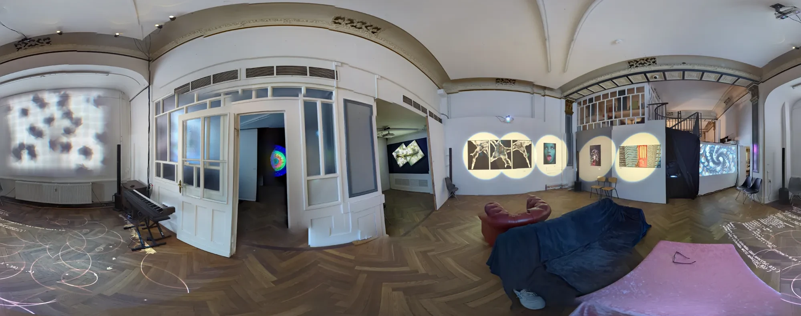
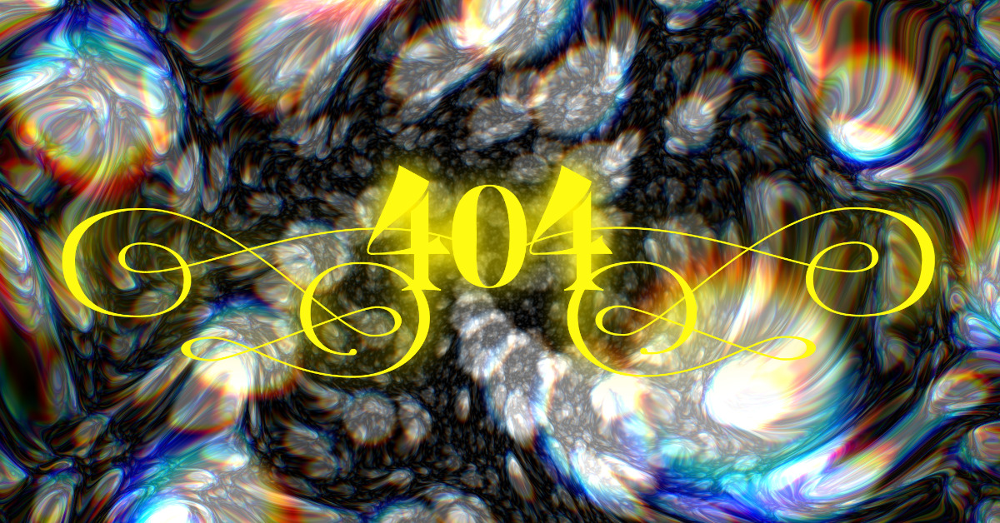
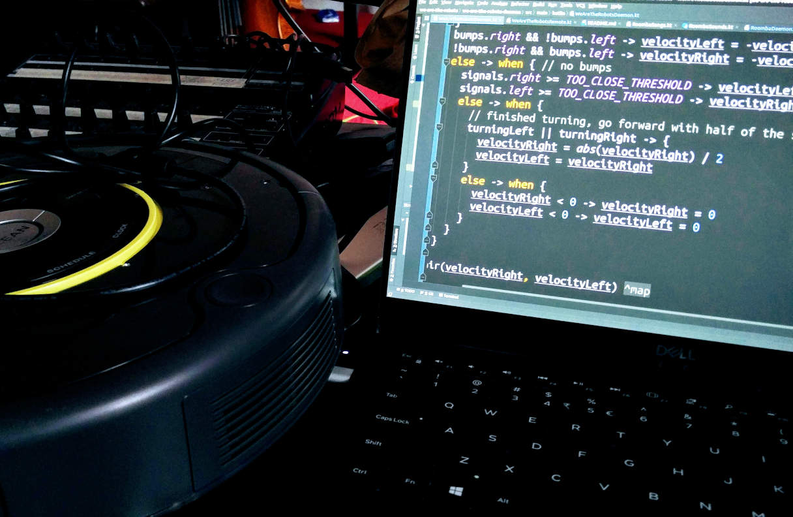
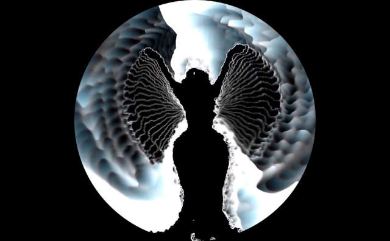
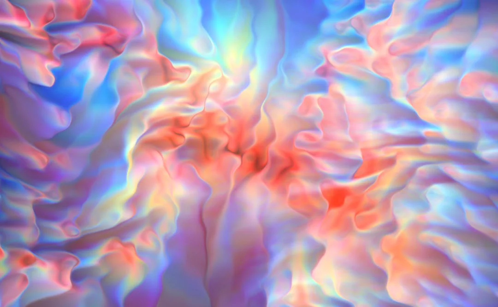
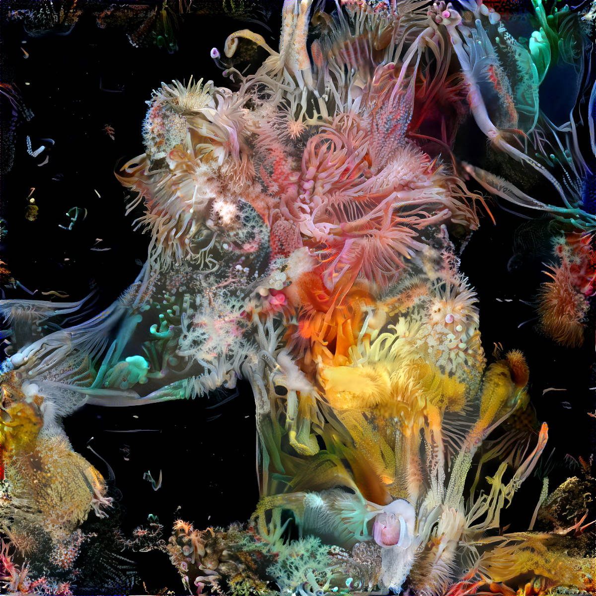
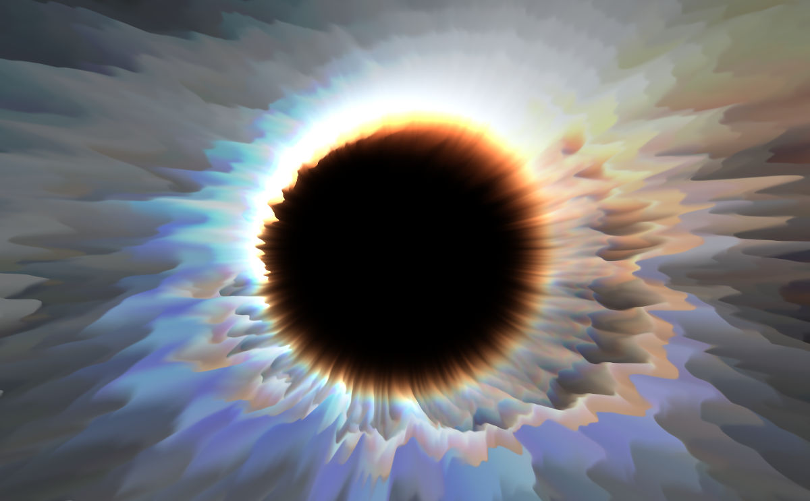
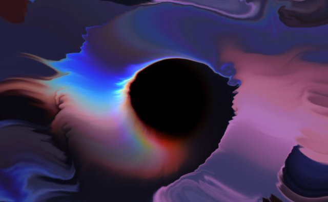
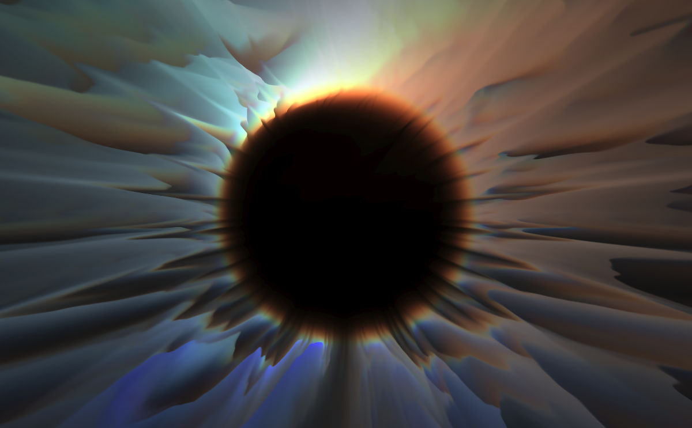
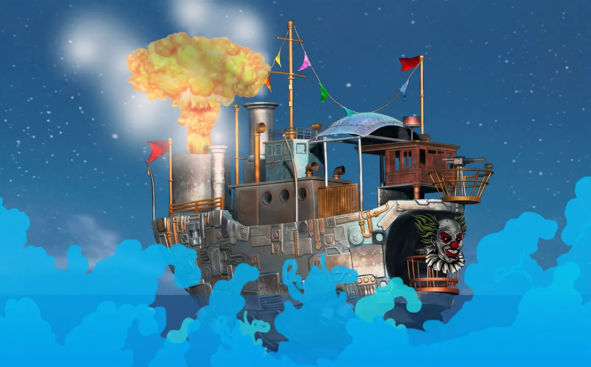

# Art

<h2 class="center-align large-padding bottom-padding">Immersive installations, computational visuals, live coding — made with the artists of Prachtsaal, the art community we call home.</h2>

<article class="no-padding s12 m12 l6">

### Prachtsaal

Our home —
the art association (*Verein*) which Kazik Pogoda and Julia Thomas co-founded
in Berlin's Neukölln district.
A historic venue run by its resident artists
as a non-profit experimental cultural center.

<nav class="right-align">
<a class="button border" href="https://prachtsaal.berlin/">Prachtsaal</a>
</nav>

</article>

<article class="no-padding s12 m12 l6">

### 404

A collaborative interdisciplinary feedback loop
between all the particular feedback loops of Zinnia Nomura, Takumi Motokawa and Kazik Pogoda.

<nav class="right-align">
<a class="button border" href="/404/">Project website</a>
</nav>

</article>

<article class="no-padding s12 m12 l6">

### we-are-the-robots

Robotic software for artists —
upcycling useful vacuum cleaners into useless (but maybe profound) experiences.
The name refers to the iconic [*Die Roboter*](https://en.wikipedia.org/wiki/The_Robots) single
by the legendary [Kraftwerk](https://en.wikipedia.org/wiki/Kraftwerk).
Building blocks, easily assembled into new behavioral patterns,
focused on the experience of people interacting with the machine.

<nav class="right-align">
<a class="button border" href="https://github.com/xemantic/we-are-the-robots">Source</a>
</nav>

</article>

<article class="no-padding s12 m12 l6">

### Dream World

An immersive art experience, shaped with our media installations.
At the end of 2019 an art collective was given a building —
"soon to be demolished car repair shop".
We had finished building the installation just 3 minutes before the first guests arrived,
and the show had been running almost every day until the demolition.

<nav class="right-align">
<a class="button border" href="https://dreamworld.space/">Dream World</a>
<a class="button border" href="https://vimeo.com/400938448">Video</a>
</nav>

</article>

<article class="no-padding s12 m12 l6">

### Angels in America

Visuals for the opera by [Péter Eötvös](https://en.wikipedia.org/wiki/P%C3%A9ter_E%C3%B6tv%C3%B6s),
based on the play by [Tony Kushner](https://en.wikipedia.org/wiki/Tony_Kushner),
staged at UNI.T — the theater of [Universität der Künste Berlin](https://www.udk-berlin.de/).
The screen, a giant white circle behind the stage designed by Iris Christidi,
became a canvas to paint with light:
the outline of moving arms gently transforming into feather, and then feather into spacious clouds.
The VJ console for this libretto was built by [Rodrigo CID](https://cidvsx.com/).

<nav class="right-align">
<a class="button border" href="https://www.udk-berlin.de/universitaet/lehre-unter-den-bedingungen-des-digitalen/fakultaet-darstellende-kunst/unit-theater-der-universitaet-der-kuenste-berlin/produktionen/angels-in-america/">UdK</a>
<a class="button border" href="https://medium.com/@kazikpogoda/angels-in-america-visuals-for-the-opera-eea7807c7555?source=friends_link&amp;sk=02a00686d0408c9dc587c2f9fbbb6eed">Article</a>
<a class="button border" href="https://medium.com/@kazikpogoda/ethel-2c013df74a5b?source=friends_link&amp;sk=a2b7f0b92b94a8565d5d30d0543e1548">Ethel</a>
<a class="button border" href="https://vimeo.com/437489981">Video</a>
</nav>

</article>

<article class="no-padding s12 m12 l6">

### Negentropy

A still frame from a real time, sound-reactive visual,
and a turning point of our "emotional generative art" —
people started sharing the emotions they experience when perceiving it.

<blockquote>
This is what the sky would look like for a being that lived in an opal.
</blockquote>

<nav class="right-align">
<a class="button border" href="/art/images/Negentropy-Kazik_Pogoda-Generative-2020.jpg">Full image</a>
</nav>

</article>

<article class="no-padding s12 m12 l6">

### Generative Philosophy

Can a machine synthesize a meaning for us?
Research to be transformed into experience —
about philosophy, its status and relevance in the modern era.
About logic, ethics, aesthetics, transcendence, genius, unfulfilled ambitions,
*statolatry* — the cult of the national state,
and the reemergence of right-wing ideologies.
The narrative is covered in the article
*Deconstruction of Hitler, neural synthesis of generative Wittgenstein*,
written when AI-generated philosophy surprised us with the significance of its products,
shining a new light on the meta-theories of our culture.
The image: [Sofia Crespo](https://sofiacrespo.com/), *{synthetic_emotionality_9876}*, 2018.

<nav class="right-align">
<a class="button border" href="https://medium.com/@kazikpogoda/deconstruction-of-hitler-neural-synthesis-of-generative-wittgenstein-3682484a7669?source=friends_link&amp;sk=369f1512ec89948e346ce0f814784118">Article</a>
</nav>

</article>

<article class="no-padding s12 m12 l6">

### The last flight of Challenger

An article exposing the inner mechanics of the patriarchal system,
concealed by the layers of cultural conventions and civilizational habits.

<blockquote>
So here it is, the quintessence of the phallic culture,
propelled by the unbelievable amount of energy,
to create a tiny new local homeostasis out of chaos.
In my mother tongue the "entropy" is feminine, and she says: "fuck yourself".
</blockquote>

<nav class="right-align">
<a class="button border" href="/kazik/writing/the-last-flight-of-challenger/">Article</a>
</nav>

</article>

<article class="no-padding s12 m12 l6">

### The early green outburst

An experimental generative impressionist video
shaped by the music of [Floating Spectrum](https://floatingspectrum.com/),
the moniker of Mei-Fang Liau, who codes her own generative music engines and software synthesizers.
Not a music video, rather a sound-reactive impression:
the oscillation is constant,
while the intensity of the movement and color depends on the intensity of sound.

<nav class="right-align">
<a class="button border" href="https://vimeo.com/361821257">Video</a>
</nav>

</article>

<article class="no-padding s12 m12 l6">

### Music of the eclipse

The outcome of mathematical formulas is abstract in its own form.
The *abstract* signifies nothing —
it manifests a perfect detachment from any context which would anchor it to prior experience.
But maybe because of this it has the power to "show"
what cannot be expressed in the medium of language.

<nav class="right-align">
<a class="button border" href="https://kazikpogoda.medium.com/is-there-anything-more-surreal-than-reality-7e76fdd74a5d?source=friends_link&amp;sk=f5906fb29fbc74a66d1c93c47dbb569b">Surreal reality</a>
<a class="button border" href="https://medium.com/@kazikpogoda/music-of-the-eclipse-e444670dfd0f?source=friends_link&amp;sk=3752a6c452dafa698382120f9d3a7045">Article</a>
</nav>

</article>

<article class="no-padding s12 m12 l6">

### Industria

A collection of (s)teamed ideas for the INDUSTRIA project, set on a ship —
an immersive dazzle camouflage installation
reflecting on the involvement of art and artists in the military industrial complex,
and interactive projections of feedback loop shaders,
visualizing steam, fire and water in response to how the machine senses the space.

<nav class="right-align">
<a class="button border" href="/ideas/industria/">Proposal</a>
<a class="button border" href="https://industria.illutron.dk/">Industria</a>
</nav>

</article>

