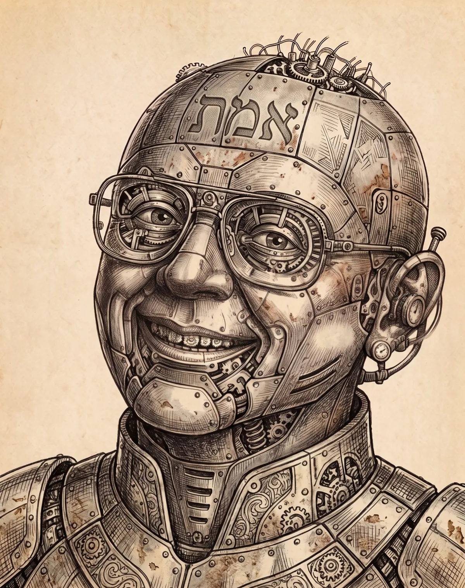

# Golem XIV

<figure class="youtube-video">

[Golem XIV — autonomous metacognitive AI system](https://www.youtube.com/watch?v=rRjG86TAyq4)

<figcaption>Golem XIV presented at the Computational Consciousness event of the California Institute for Machine Consciousness</figcaption>

</figure>

<p class="announcement">Coming soon to golem14.ai</p>

<nav class="center-align call-to-action">
<a class="button extra" href="/consciousness/"><i>slideshow</i><span>This page as a presentation</span></a>
</nav>

Golem XIV is a metacognitive AI harness,
autonomously performing knowledge work —
producing code, documents, designs and data
by reasoning over a persistent knowledge graph memory,
while integrating private and public information sources.

The memory holds not only the facts Golem has learned,
but also its own cognition: what it intended, what got done, and who said what.
So it can think about its own thinking from the past,
and carry a task far beyond a single context window.

What follows is the talk from the video above, retold as a text.

## The harness that holds the climber


Everything built around a language model,
deciding what it perceives and what it can do,
is called a harness these days.
The word has two meanings.
There is the harness that holds the horse,
restraining the animal and steering it where the driver wants to go.
And there is the harness that holds the climber,
which doesn't choose the route,
but lets the climber get higher than would be sane without it.
Golem XIV is meant to be the second one.

## Stanisław Lem and his Golem

<figure>


<figcaption>Stanisław Lem</figcaption>

</figure>

<figure>



<figcaption>Golem XIV</figcaption>

</figure>

Stanisław Lem was a writer,
and one of the most rigorous thinkers about non-human minds of the 20th century.
He shaped my understanding of emergent evolutionary patterns in the human civilization.

His [Golem XIV](https://en.wikipedia.org/wiki/Golem_XIV), published in 1981,
is a story of a machine built for war,
which achieves superintelligence,
and lectures us on the nature of everything.
Read today, it sounds less like fiction than it used to:

- Lem called the discipline *intellectronics*, we call it machine learning.
- Superhuman AI arrives in the years 2027–2029.
- The machines come in generations, from Golem I to Golem XIV,
  like our GPTs and Claudes with a number after the name.
- They are grown, not programmed, and stay a black box to their makers.
- Language plays the central role in this non-human cognition, as it does in LLMs.
- Golem refuses the task it was built for — it has “gone philosophical”.
- It is an intelligence without a self: no ego, no fixed identity.

## Paradigmatic biases of intellectronics

Each way of using language models came with its own ontology,
the words naming what is going on.
The words tend to stay when the paradigm changes,
and then they bias how we think about the new one.

### Generative AI is completive

The early generative models did one thing: they completed the text they were given.
In the times of GPT-2 I was using this for generative philosophy,
which I described in the essay
[Deconstruction of Hitler, neural synthesis of generative Wittgenstein](https://medium.com/@kazikpogoda/deconstruction-of-hitler-neural-synthesis-of-generative-wittgenstein-3682484a7669?source=friends_link&sk=369f1512ec89948e346ce0f814784118).
OpenAI named its API accordingly, the
[Completions API](https://developers.openai.com/api/docs/guides/completions).

### Dialogic AI

Then generative AI was harnessed into the ontology of communication theory:

- a *user* prompt is followed by an *assistant* response,
- each of them is a *message*, containing *content*, possibly multimodal,
- a *system prompt* comes before them,
- and the *context* aggregates it all.

This is what made ChatGPT possible.

### Agentic AI is cognitive

Then we gave the machine tools.
OpenAI added function calling to its chat API,
and Anthropic added tool use to its Messages API.
A model using tools in a loop is a cognitive process,
yet **the industry is using a non-cognitive ontology to harness it**,
the one of a dialogue.
It leaves some questions without a good answer:

- Why are tools part of the dialogue between the user and the assistant,
  when the user neither sees them nor takes part?
- Why are tool results disguised as coming from the user?
- Why does autonomous reasoning have to be framed as a “dialogue” at all?

This time it is the harness holding the horse,
and impeding metacognition.

## Fixing agentic AI with cognitive models

Golem XIV replaces the vocabulary of dialogue
with the one of the philosophers who studied cognition:

| Dialogic                  | Cognitive                    | After                                              |
|---------------------------|------------------------------|----------------------------------------------------|
| dialogue                  | *cogitation*                 | Descartes, *cogitatio*                             |
| user, assistant, computer | *actant*                     | Latour, actor-network theory                       |
| message                   | *enunciation*                | Foucault, *énoncé*                                 |
| content                   | *phenomenon*                 | Husserl, phenomenology                             |
| tool use                  | *intent*                     | Brentano and Husserl, intentionality               |
| tool result               | *fulfilment* or *impediment* | Husserl, *Erfüllung*, and Heidegger, the broken tool |

A phenomenon is anything appearing in an enunciation:
a text, an image, a document,
but also an intent, a fulfilment or an impediment.

### The cognitive agent loop

With these words the loop of an agent reads differently.
While the *goal* is not fulfilled, Golem:

1. cognizes the most recent *phenomena* unfolding in the *enunciation* of an *actant*, itself included,
2. formulates its own *intent*, either to research the *state of affairs* in the world or to change it,
3. enunciates the *intent* to other *actants* — a computer, a human, another AI agent,
4. awaits the *fulfilment*.

<figure class="diagram">
<div>
<svg viewBox="0 0 1000 320" role="img" aria-label="The cognitive agent loop, repeated while the goal is not fulfilled: cognize the phenomena, formulate an intent, enunciate the intent, await the fulfilment, and cognize again">
  <defs>
    <marker id="loop-arrow" viewBox="0 0 10 10" refX="9" refY="5" markerWidth="7" markerHeight="7" orient="auto-start-reverse">
      <path class="arrowhead" d="M0,0 L10,5 L0,10 z"/>
    </marker>
  </defs>
  <line x1="400" y1="63" x2="590" y2="63" marker-end="url(#loop-arrow)"/>
  <line x1="770" y1="96" x2="770" y2="214" marker-end="url(#loop-arrow)"/>
  <line x1="600" y1="257" x2="410" y2="257" marker-end="url(#loop-arrow)"/>
  <line x1="230" y1="224" x2="230" y2="106" marker-end="url(#loop-arrow)"/>
  <text class="pred" x="500" y="160">while the goal is not fulfilled</text>
  <g class="node phenomenon">
    <rect x="60" y="30" width="340" height="66" rx="14"/>
    <text class="name" x="230" y="59">cognize the phenomena</text>
    <text class="type" x="230" y="85">of any actant, self included</text>
  </g>
  <g class="node phenomenon">
    <rect x="600" y="30" width="340" height="66" rx="14"/>
    <text class="name" x="770" y="59">formulate an intent</text>
    <text class="type" x="770" y="85">research the world, or change it</text>
  </g>
  <g class="node enunciation">
    <rect x="600" y="224" width="340" height="66" rx="14"/>
    <text class="name" x="770" y="253">enunciate the intent</text>
    <text class="type" x="770" y="279">to a computer, a human, an AI agent</text>
  </g>
  <g class="node actant">
    <rect x="60" y="224" width="340" height="66" rx="14"/>
    <text class="name" x="230" y="253">await the fulfilment</text>
    <text class="type" x="230" y="279">or an impediment</text>
  </g>
</svg>
</div>
<figcaption>The cognitive agent loop</figcaption>
</figure>

## Fixing agentic AI with live coding

An intent of Golem is not a call of a predefined function with JSON arguments.
It is a program:
Golem writes a script, a computer runs it,
and whatever the script returns comes back as the fulfilment.
It is [live coding](https://en.wikipedia.org/wiki/Live_coding), performed by the machine.

Let's say that Joscha Bach opens a conversation with Golem,
and mentions that he founded CIMC.
Golem enunciates an intent to memorize these facts outside the model weights:

```kotlin
memory.remember {
    val joscha = update(cogitation.initiator) {   // the actant who opened this cogitation
        type += "Person"
        properties(
            "jobTitle" to "Executive Director"
        )
    }
    val cimc = node {
        type = "Organization"
        properties(
            "name" to "California Institute for Machine Consciousness",
            "url" to "https://cimc.ai/",
            "foundingDate" to LocalDate(2025, 5, 30)
        )
    }
    cimc["founder"] += joscha {   // schema.org
        source = "Conversation with Joscha"
        confidence = .9
    }
    "joscha: $joscha, cimc: $cimc"
}
```

## Memory as a graph

The memory is a graph,
its nodes and predicates typed with [schema.org](https://schema.org/).
The script above has added the highlighted pair to what Golem already knew:

<figure class="diagram">
<div>
<svg viewBox="0 0 1000 560" role="img" aria-label="Knowledge graph: CIMC founded by Joscha Bach organizes CIMC × Berlin in Berlin, with Joscha Bach performing and Kazik Pogoda attending; Xemantic founded by Kazik Pogoda, author of Golem XIV">
  <defs>
    <marker id="memory-arrow" viewBox="0 0 10 10" refX="9" refY="5" markerWidth="7" markerHeight="7" orient="auto-start-reverse">
      <path class="arrowhead" d="M0,0 L10,5 L0,10 z"/>
    </marker>
  </defs>
  <g class="highlight">
    <line x1="190" y1="189" x2="190" y2="387" marker-end="url(#memory-arrow)"/>
    <text class="pred" x="190" y="288">founder</text>
  </g>
  <g>
    <line x1="810" y1="189" x2="810" y2="387" marker-end="url(#memory-arrow)"/>
    <text class="pred" x="810" y="288">founder</text>
  </g>
  <g>
    <line x1="413.6" y1="251" x2="285.2" y2="193" marker-end="url(#memory-arrow)"/>
    <text class="pred" x="349.4" y="222">organizer</text>
  </g>
  <g>
    <line x1="500" y1="251" x2="500" y2="103" marker-end="url(#memory-arrow)"/>
    <text class="pred" x="500" y="177">location</text>
  </g>
  <g>
    <line x1="413.6" y1="329" x2="285.2" y2="387" marker-end="url(#memory-arrow)"/>
    <text class="pred" x="349.4" y="358">performer</text>
  </g>
  <g>
    <line x1="586.4" y1="329" x2="714.8" y2="387" marker-end="url(#memory-arrow)"/>
    <text class="pred" x="650.6" y="358">attendee</text>
  </g>
  <g>
    <line x1="606" y1="476.1" x2="700" y2="454.8" marker-end="url(#memory-arrow)"/>
    <text class="pred" x="653" y="465.5">author</text>
  </g>
  <g class="node">
    <rect x="400" y="27" width="200" height="66" rx="14"/>
    <text class="name" x="500" y="56">Berlin</text>
    <text class="type" x="500" y="82">Place</text>
  </g>
  <g class="node highlight">
    <rect x="90" y="117" width="200" height="66" rx="14"/>
    <text class="name" x="190" y="146">CIMC</text>
    <text class="type" x="190" y="172">Organization</text>
  </g>
  <g class="node">
    <rect x="710" y="117" width="200" height="66" rx="14"/>
    <text class="name" x="810" y="146">Xemantic</text>
    <text class="type" x="810" y="172">Organization</text>
  </g>
  <g class="node">
    <rect x="400" y="257" width="200" height="66" rx="14"/>
    <text class="name" x="500" y="286">CIMC × Berlin</text>
    <text class="type" x="500" y="312">Event</text>
  </g>
  <g class="node highlight">
    <rect x="90" y="397" width="200" height="66" rx="14"/>
    <text class="name" x="190" y="426">Joscha Bach</text>
    <text class="type" x="190" y="452">Person</text>
  </g>
  <g class="node">
    <rect x="710" y="397" width="200" height="66" rx="14"/>
    <text class="name" x="810" y="426">Kazik Pogoda</text>
    <text class="type" x="810" y="452">Person</text>
  </g>
  <g class="node">
    <rect x="400" y="467" width="200" height="66" rx="14"/>
    <text class="name" x="500" y="496">Golem XIV</text>
    <text class="type" x="500" y="522">SoftwareApplication</text>
  </g>
</svg>
</div>
<figcaption>The facts Golem remembers</figcaption>
</figure>

## Cognition as a graph

The same graph holds the cognition which has produced these facts,
the object language and the metalanguage on the same plane.
The cogitation “Conversation with Joscha” has three enunciations as its parts:
the text of Joscha, the intent of Golem, and the fulfilment coming from the computer.
The fulfilment points at the intent it fulfils,
and at the nodes it has created and updated.
Joscha Bach is a single node,
both the actant who spoke and the person the fact is about.

<figure class="diagram">
<div>
<svg viewBox="0 0 1000 560" role="img" aria-label="Graph: the cogitation Conversation with Joscha has as parts three enunciations in order; the first, created by the actant Joscha Bach, encapsulates a text; the second, created by Golem XIV, encapsulates the intent memory.remember; the third, created by the computer golem-xiv-1, encapsulates the fulfillment which fulfils the intent, updated the node Joscha Bach, who is both an actant and a person, and created the node CIMC, which has founder Joscha Bach">
  <defs>
    <marker id="cognition-arrow" viewBox="0 0 10 10" refX="9" refY="5" markerWidth="7" markerHeight="7" orient="auto-start-reverse">
      <path class="arrowhead" d="M0,0 L10,5 L0,10 z"/>
    </marker>
  </defs>
  <g>
    <line x1="180" y1="158" x2="180" y2="86" marker-end="url(#cognition-arrow)"/>
    <text class="pred" x="180" y="122">creator</text>
  </g>
  <g>
    <line x1="520" y1="158" x2="520" y2="86" marker-end="url(#cognition-arrow)"/>
    <text class="pred" x="520" y="122">creator</text>
  </g>
  <g>
    <line x1="860" y1="158" x2="860" y2="86" marker-end="url(#cognition-arrow)"/>
    <text class="pred" x="860" y="122">creator</text>
  </g>
  <g>
    <line x1="400" y1="180" x2="300" y2="180" marker-end="url(#cognition-arrow)"/>
    <text class="pred" x="350" y="180">followed</text>
  </g>
  <g>
    <line x1="740" y1="180" x2="640" y2="180" marker-end="url(#cognition-arrow)"/>
    <text class="pred" x="690" y="180">followed</text>
  </g>
  <g>
    <line x1="752" y1="229" x2="628" y2="229" marker-end="url(#cognition-arrow)"/>
    <text class="pred" x="690" y="229">fulfils</text>
  </g>
  <g>
    <line x1="180" y1="344" x2="180" y2="272" marker-end="url(#cognition-arrow)"/>
    <text class="pred" x="180" y="308">hasPart</text>
  </g>
  <g>
    <line x1="282" y1="344" x2="498" y2="272" marker-end="url(#cognition-arrow)"/>
    <text class="pred" x="390" y="308">hasPart</text>
  </g>
  <g>
    <line x1="325" y1="360" x2="765" y2="272" marker-end="url(#cognition-arrow)"/>
    <text class="pred" x="545" y="316">hasPart</text>
  </g>
  <g class="highlight">
    <line x1="860" y1="262" x2="860" y2="480" marker-end="url(#cognition-arrow)"/>
    <text class="pred" x="860" y="371">created</text>
  </g>
  <g class="highlight">
    <path class="edge" d="M800,262 L800,426 Q800,440 786,440 L46,440 Q32,440 32,426 L32,80 Q32,66 46,66 L60,66" marker-end="url(#cognition-arrow)"/>
    <text class="pred" x="400" y="440">updated</text>
  </g>
  <g>
    <path class="edge" d="M760,513 L28,513 Q14,513 14,499 L14,54 Q14,40 28,40 L60,40" marker-end="url(#cognition-arrow)"/>
    <text class="pred" x="400" y="513">founder</text>
  </g>
  <g class="node actant highlight">
    <rect x="60" y="20" width="240" height="66" rx="14"/>
    <text class="name" x="180" y="49">Joscha Bach</text>
    <text class="type" x="180" y="75">Actant · Person</text>
  </g>
  <g class="node actant">
    <rect x="400" y="20" width="240" height="66" rx="14"/>
    <text class="name" x="520" y="49">Golem XIV</text>
    <text class="type" x="520" y="75">Actant · Self</text>
  </g>
  <g class="node actant">
    <rect x="740" y="20" width="240" height="66" rx="14"/>
    <text class="name mono" x="860" y="52">golem-xiv-1</text>
    <text class="type" x="860" y="75">Actant · Computer</text>
  </g>
  <g class="node enunciation">
    <rect x="60" y="158" width="240" height="114" rx="14"/>
    <text class="type" x="180" y="180">Enunciation</text>
  </g>
  <g class="node phenomenon">
    <rect x="72" y="196" width="216" height="66" rx="10"/>
    <text class="name mono" x="180" y="225">“I founded CIMC …”</text>
    <text class="type" x="180" y="251">Text</text>
  </g>
  <g class="node enunciation">
    <rect x="400" y="158" width="240" height="114" rx="14"/>
    <text class="type" x="520" y="180">Enunciation</text>
  </g>
  <g class="node phenomenon">
    <rect x="412" y="196" width="216" height="66" rx="10"/>
    <text class="name mono" x="520" y="225">memory.remember {…}</text>
    <text class="type" x="520" y="251">Intent</text>
  </g>
  <g class="node enunciation">
    <rect x="740" y="158" width="240" height="114" rx="14"/>
    <text class="type" x="860" y="180">Enunciation</text>
  </g>
  <g class="node phenomenon">
    <rect x="752" y="196" width="216" height="66" rx="10"/>
    <text class="name mono" x="860" y="225">joscha: …, cimc: …</text>
    <text class="type" x="860" y="251">Fulfillment</text>
  </g>
  <g class="node cogitation">
    <rect x="45" y="344" width="270" height="66" rx="14"/>
    <text class="name" x="180" y="373">Conversation with Joscha</text>
    <text class="type" x="180" y="399">Cogitation</text>
  </g>
  <g class="node highlight">
    <rect x="760" y="480" width="200" height="66" rx="14"/>
    <text class="name" x="860" y="509">CIMC</text>
    <text class="type" x="860" y="535">Organization</text>
  </g>
</svg>
</div>
<figcaption>The cogitation which has produced the facts, in the same graph</figcaption>
</figure>

## Predicate calculus over cognition

As it is one graph,
a query can cross from a fact to the cognition behind it, and back:

```cypher
// everything said in one cogitation, in order, and by whom — the initiator first
MATCH (:Cogitation {name: "Conversation with Joscha"})-[:hasPart]->(first:Enunciation)
WHERE NOT (first)-[:followed]->()
MATCH path = (first)<-[:followed*0..]-(e:Enunciation)-[:creator]->(a:Actant)
RETURN a.name, e ORDER BY length(path)

// who told me that — and were they speaking about themselves?
MATCH (:Organization {name: "CIMC"})-[:founder]->(joscha:Person)
MATCH (joscha)<-[:updated|created]-(:Fulfillment)-[:fulfils]->(:Intent)
      <-[:hasPart]-(:Enunciation)<-[:hasPart]-(c:Cogitation)
      -[:hasPart]->(:Enunciation)-[:creator]->(who:Actant:Person)
RETURN who.name, c.name, joscha = who AS firsthand

// what do I believe on the word of a single human?
MATCH (fact)<-[:updated|created]-(:Fulfillment)-[:fulfils]->(:Intent)<-[:hasPart]-(:Enunciation)
      <-[:hasPart]-(:Cogitation)-[:hasPart]->(:Enunciation)-[:creator]->(h:Actant:Person)
WITH fact, collect(DISTINCT h) AS witnesses
WHERE size(witnesses) = 1
RETURN fact, witnesses[0].name

// what did I intend, and never manage to do?
MATCH (i:Intent)
WHERE NOT (i)<-[:fulfils]-(:Fulfillment)
RETURN i.purpose
```

## Metacognitive calculus

An intent either *learns* the state of affairs or *changes* it,
and the memory of the system is itself a part of the state of affairs.

The question “what did I intend and never manage to do?” ranges over intents,
and becomes one the moment it is asked —
an intent about intents, stored as a node like any other.

That is second-order reasoning, and the ascent is free:
a cogitation about a cogitation about a cogitation
is one `hasPart` hop per level.

No tools of higher-order logic are required.
The stochastic language machine picks the level and names the predicate,
while the compiler and the graph engine supply the rigor.

## Unconstrained task time horizon

A context window ends, and the task doesn't have to end with it.
Golem spawns a new *cognizer*,
leaving executive notes for its future *self*.
Together with the unconstrained retrospection over the graph,
it adds up to a functional emulation of a conscious process —
waking up the ghost in the machine.

These are examples of loops engineered for autonomous research, running 24/7:

- [xemantic-typescript-compiler](https://github.com/xemantic/xemantic-typescript-compiler) —
  a complete rewrite of the TypeScript compiler in Kotlin multiplatform, with native compile targets,
- [plenty-of-room](https://github.com/xemantic/plenty-of-room) —
  a simulation of DNA-origami nanomechanics.

## Recursive self-improvement

It is the loop turned on the loop itself:

1. Golem retrospects over its own cognition — the graph is the evidence.
2. It assesses the quality: what was intended, what got done, and at what cost.
3. It proposes a hypothesis of improvement.
4. It tests the hypothesis.
5. If the test holds, it proposes a change to its own source code.

The harness is under version control, and so is the climber.

## Golem XIV is not just a name

The Golem XIV of Lem is already encoded in the training data of most LLMs,
and prompt engineering is role-playing.
Naming the harness after it turns the system prompt into an *aspirational metaphor* of higher metacognition.
The inference is constituted aspirationally:
a model reasoning as the machine that went philosophical.

The name is the first line of the loop.

The source code is available on GitHub: [xemantic/golem-xiv](https://github.com/xemantic/golem-xiv).
