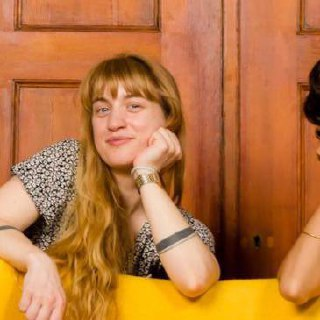
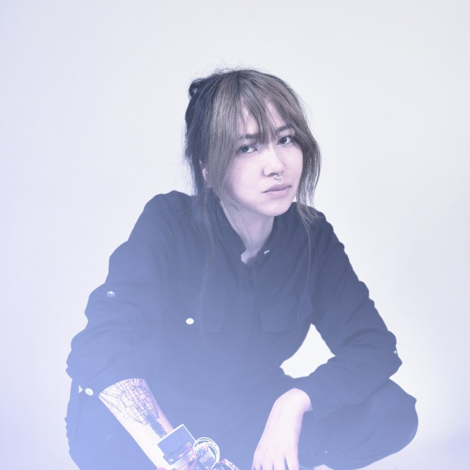

# Humans

## Collective

<article class="border s12 m6 l4">

### Kazik Pogoda

Co-founder, AI engineer and software architect.

I started Xemantic years ago to research the connection between language and meaning.
Now, in the era of neurosymbolic AI,
this research is more relevant than ever.

* Coder, system architect and tech lead with over two decades of experience
* Philosopher, focused on cognitive science
* Computational artist and creative technologist,
  contributor to the [OPENRNDR](https://openrndr.org/) creative coding framework

<nav class="right-align">
<a class="button transparent" href="../kazik/">More<i>arrow_forward</i></a>
<a class="button transparent" href="https://www.linkedin.com/in/kpogoda/">LinkedIn<i>north_east</i></a>
</nav>

</article>

<article class="border s12 m6 l4">

### Julia Thomas

Co-founder, psychology and data science.

* Machine learning specialist at [Krisenchat](https://krisenchat.de/)
* Data scientist, clinical psychologist and counselor
* Author of several papers on the intersection of machine learning, psychology and society

<nav class="right-align">
<a class="button transparent" href="https://www.linkedin.com/in/julia-thomas-a5ba27214/">LinkedIn<i>north_east</i></a>
</nav>

</article>

<article class="border s12 m6 l4">

### Julie Amouzegar Kim

AI and software development, design.

* Designer, 3D modeler and UX specialist, embracing new aesthetics
* Composer, inventor and new media artist
* Collaborated with Kazik on the [404](../404/) and
  [Synaesthesia and the Mathematics of Perception](https://youtu.be/KGK2W7cwQuw) projects

<nav class="right-align">
<a class="button transparent" href="https://www.linkedin.com/in/julie-amouzegar-b72bb120b/">LinkedIn<i>north_east</i></a>
</nav>

</article>

## Advisors

<article class="border s12 m6">

<i class="primary-text">person</i>

### Artur Kos

TODO: role and short bio.

</article>

<article class="border s12 m6">

<i class="primary-text">person</i>

### Daniela van den Heijden

TODO: role and short bio.

</article>

