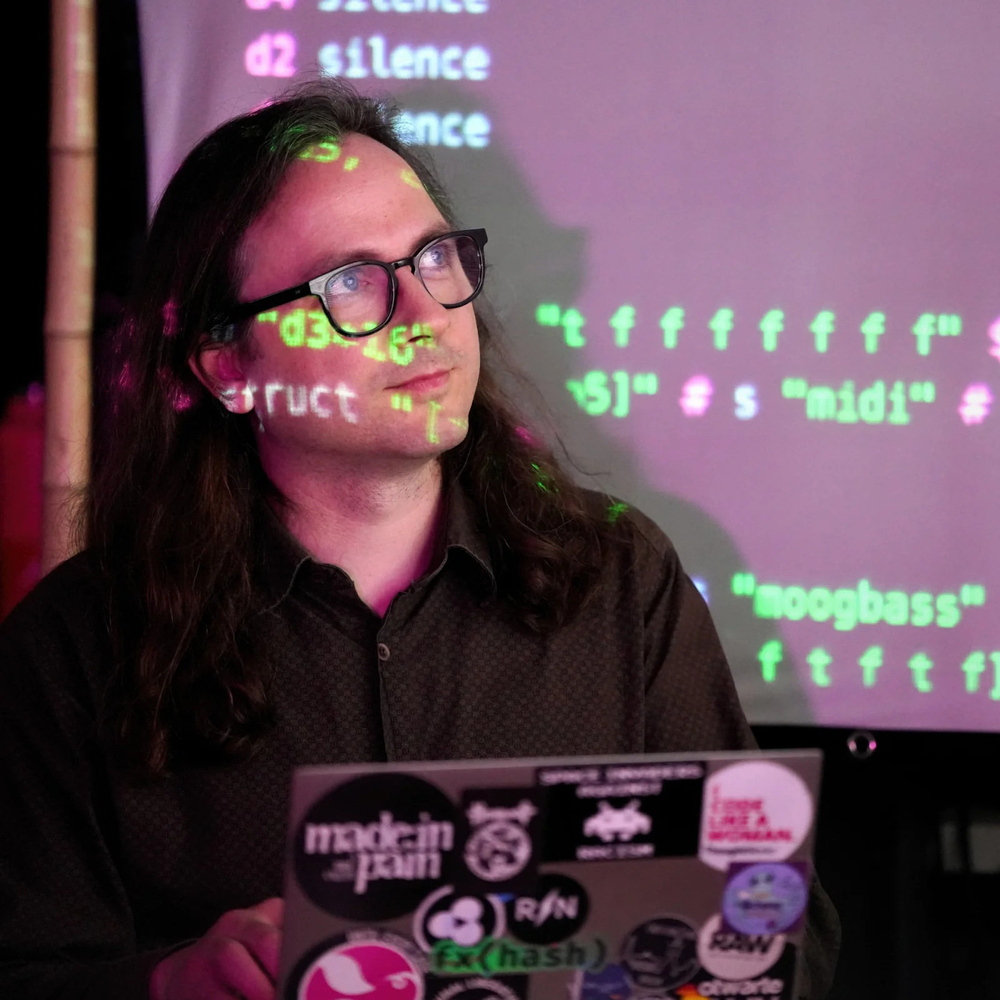
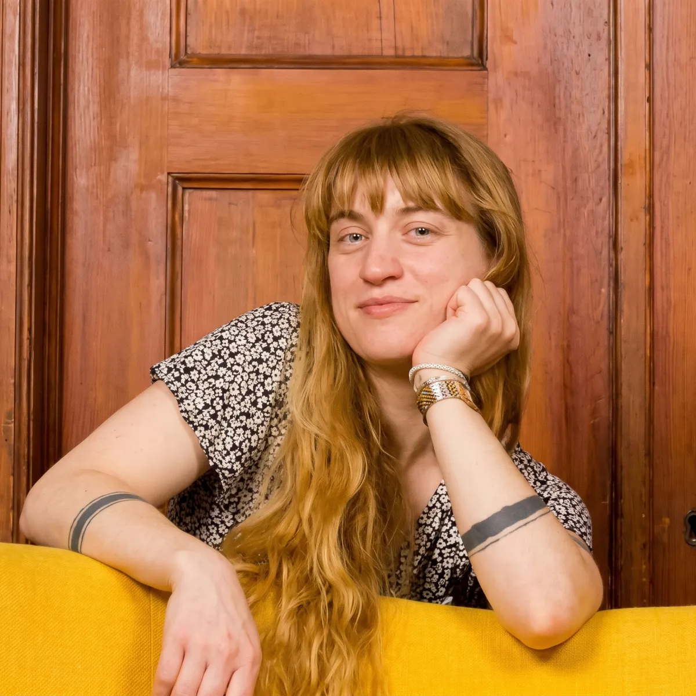
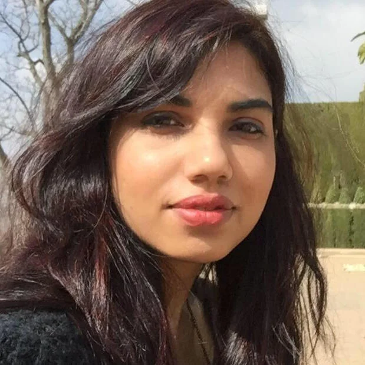
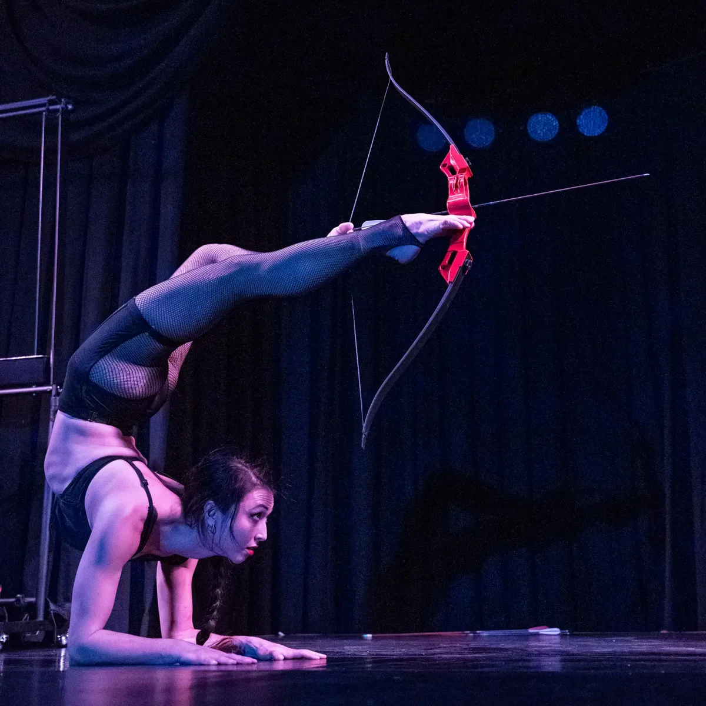
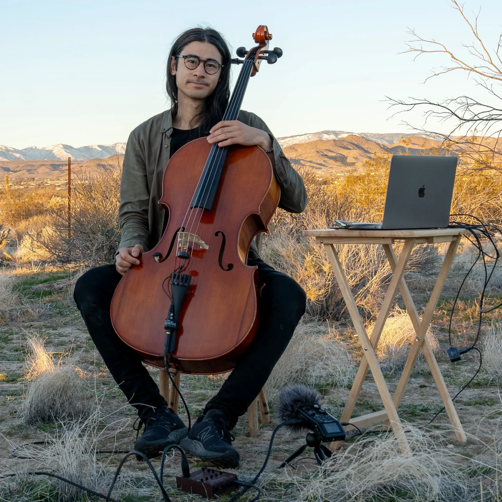
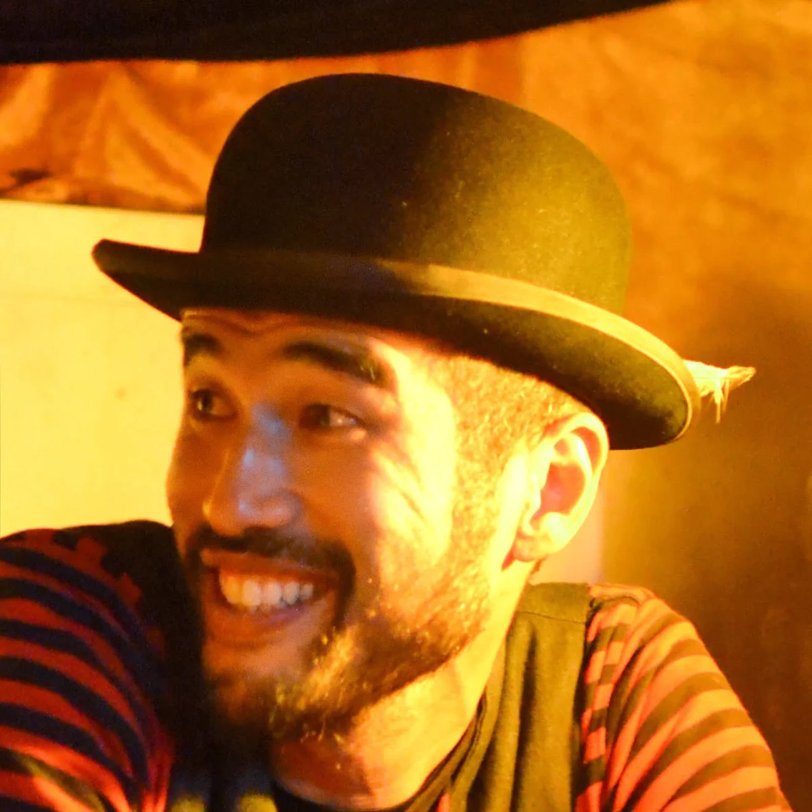
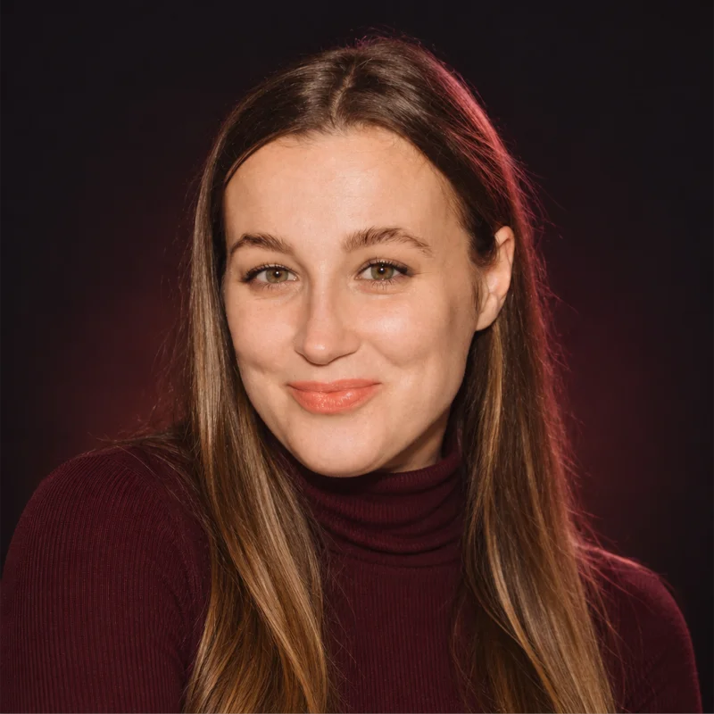
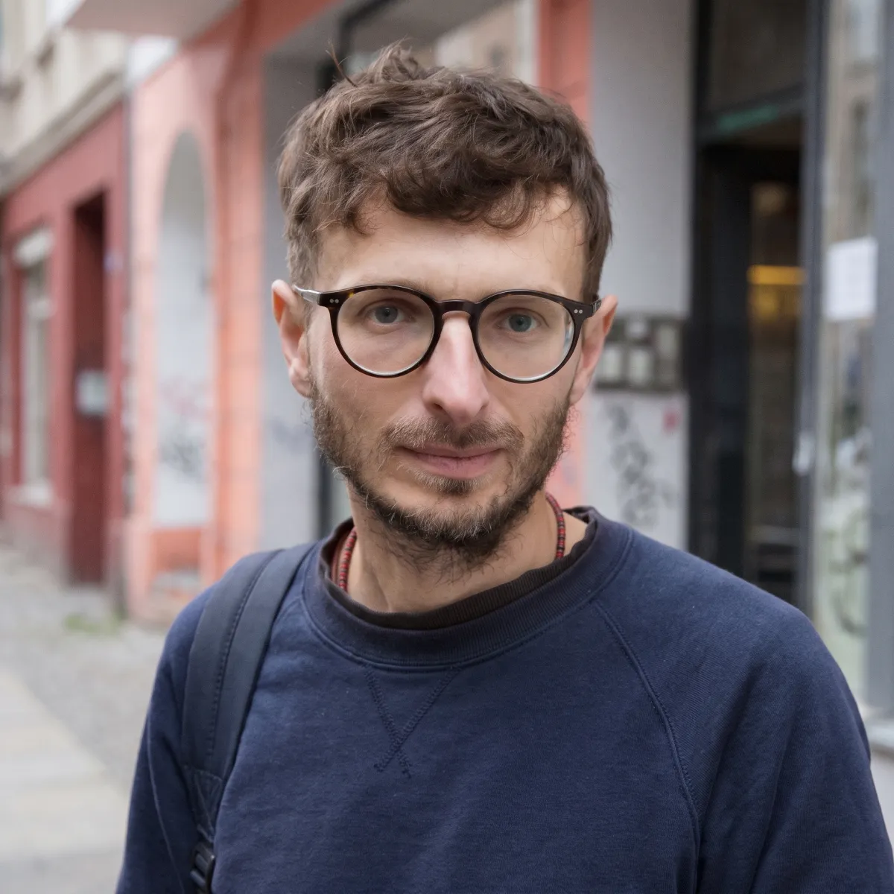
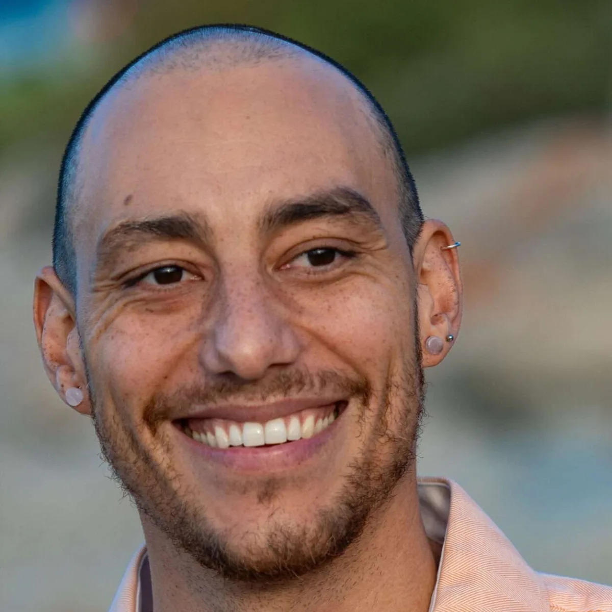
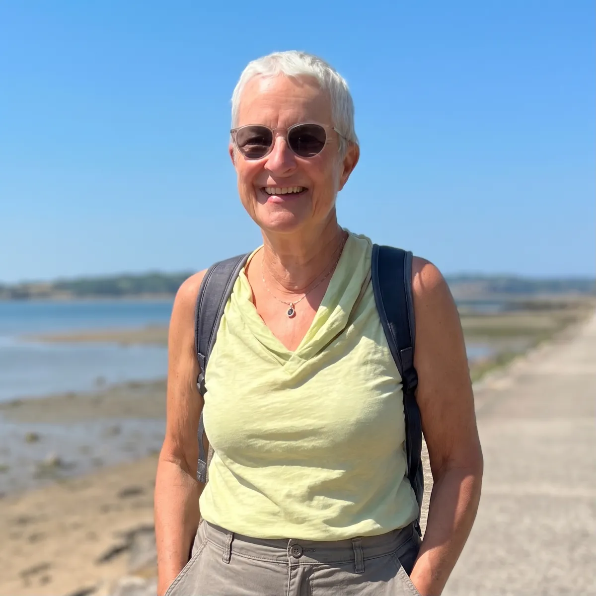

# Humans

## Collective

<article class="no-padding s12 m6 l4">

### Kazik Pogoda

*Founder, AI researcher, system architect*

- CTO
- AI
- Claude Ambassador
- Foresight Institute
- Science
- Philosophy
- Cognitive Science
- Computational Art

<nav class="right-align">

- [LinkedIn](https://www.linkedin.com/in/kpogoda/)
- [GitHub](https://github.com/morisil/)
- [Instagram](https://www.instagram.com/xemantic.berlin)

<a class="button" href="../kazik/">More</a>
</nav>

</article>

<article class="no-padding s12 m6 l4">

### Julia Thomas

*Founder, AI researcher, psychologist*

- AI
- ML
- Data Science
- Psychology
- Counseling
- Philosophy
- Society
- Art

<nav class="right-align">

- [LinkedIn](https://www.linkedin.com/in/julia-thomas-a5ba27214/)

</nav>

</article>

<article class="no-padding s12 m6 l4">

### Julie Amouzegar Kim

*Designer, computational artist, composer*

- Design
- 3D
- UX
- Music
- New Media Art
- Computational Art
- Synaesthesia

<nav class="right-align">

- [LinkedIn](https://www.linkedin.com/in/julie-amouzegar-b72bb120b/)
- [Instagram](https://www.instagram.com/zuomarage/)

</nav>

</article>

## Collaborators

<article class="no-padding s12 m6 l4">

### Babita Singh

*Senior researcher, scientific advisor*

- AIxBio
- Biomedicine
- Bioinformatics
- Genomics
- AI Biosafety
- Personalised Medicine
- Foresight Institute

<nav class="right-align">

- [LinkedIn](https://www.linkedin.com/in/babita2305/)

<a class="button border" href="https://babitasingh.es/">Website</a>
</nav>

</article>

<article class="no-padding s12 m6 l4">

### Zinnia Nomura

*Circus artist, contortionist, aerialist*

- Circus
- Contortion
- Aerial Arts
- Foot Archery
- Ballet
- Dance
- Venice Biennale

<nav class="right-align">

- [LinkedIn](https://www.linkedin.com/in/zinnia-nomura/)
- [Instagram](https://www.instagram.com/zinniamoves/)

<a class="button border" href="https://zinnianomura.com/">Website</a>
</nav>

</article>

<article class="no-padding s12 m6 l4">

### Paul Schneider

*Health economist, medical doctor, forecaster*

- Foresight Institute
- HEOR
- Health Economics
- AI Evals
- Decision Science
- Forecasting
- Open Science

<nav class="right-align">

- [LinkedIn](https://www.linkedin.com/in/paul--/)

<a class="button border" href="https://abundanceds.com/">Abundance Decision Systems</a>
</nav>

</article>

<article class="no-padding s12 m6 l4">

### Dan Gorelick

*Artist, cellist, live coder*

- Cello
- Live Coding
- Generative Music
- Sound Art
- Art & Code
- NEW INC

<nav class="right-align">

- [LinkedIn](https://www.linkedin.com/in/dqgorelick/)
- [Instagram](https://www.instagram.com/dqgorelick/)

<a class="button border" href="https://www.dan.dog/">Website</a>
</nav>

</article>

<article class="no-padding s12 m6 l4">

### Monika Tichy

*Activist, journalist, pacifist*

- Activism
- Journalism
- Pacifism
- Feminism
- LGBTQ+ Rights
- Trans Pride
- Motorcycles

<nav class="right-align">

- [Instagram](https://www.instagram.com/pac.ink.a/)

<a class="button border" href="https://linktr.ee/pacyfka">Linktree</a>
</nav>

</article>

<article class="no-padding s12 m6 l4">

### Keith Lim

*Interdisciplinary artist: interactivity, technology, performance*

- Immersive Theatre
- Interactive Installations
- Performance
- Dance
- Digital Art
- Computer Science
- Psychology

<nav class="right-align">

- [LinkedIn](https://www.linkedin.com/in/keiththesedays/)
- [Instagram](https://www.instagram.com/keiththesedays/)

<a class="button border" href="https://keithlim.art/">Website</a>
</nav>

</article>

## Advisors

<article class="no-padding s12 m6 l4">

### Goda Go

*AI educator, community builder, architect*

- Claude Ambassador
- AI Education
- AI Agents
- Claude Code
- Community
- YouTube
- TEDx
- Architecture

<nav class="right-align">

- [LinkedIn](https://www.linkedin.com/in/godago)
- [YouTube](https://www.youtube.com/@godago)

</nav>

</article>

<article class="no-padding s12 m6 l4">

### Artur Kos

*Founder of Blackbird Collective, recruiter, psychologist by education*

- Recruiting
- HR
- Tech Talent
- Psychology
- Four-Day Week
- Languages

<nav class="right-align">

- [LinkedIn](https://www.linkedin.com/in/arturkos/)

<a class="button border" href="https://www.theblackbird.de/">Blackbird Collective</a>
</nav>

</article>

<article class="no-padding s12 m6 l4">

### Bradley Royes

*Community builder, cognitive scientist, tennis coach*

- Foresight Institute
- AI Node Berlin
- Cognitive Science
- Community
- Operations
- Experience Design

<nav class="right-align">

- [LinkedIn](https://www.linkedin.com/in/bradleyroyes)

<a class="button border" href="https://www.bradleyroyes.com/">Website</a>
</nav>

</article>

<article class="no-padding s12 m6 l4">

### Daniela van den Heijden

TODO: role and short bio.

</article>

