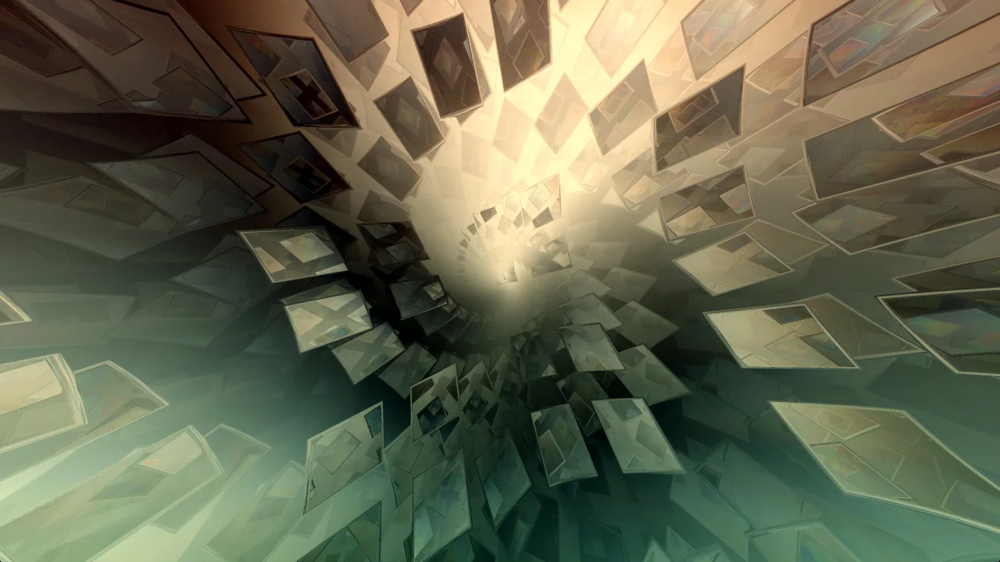
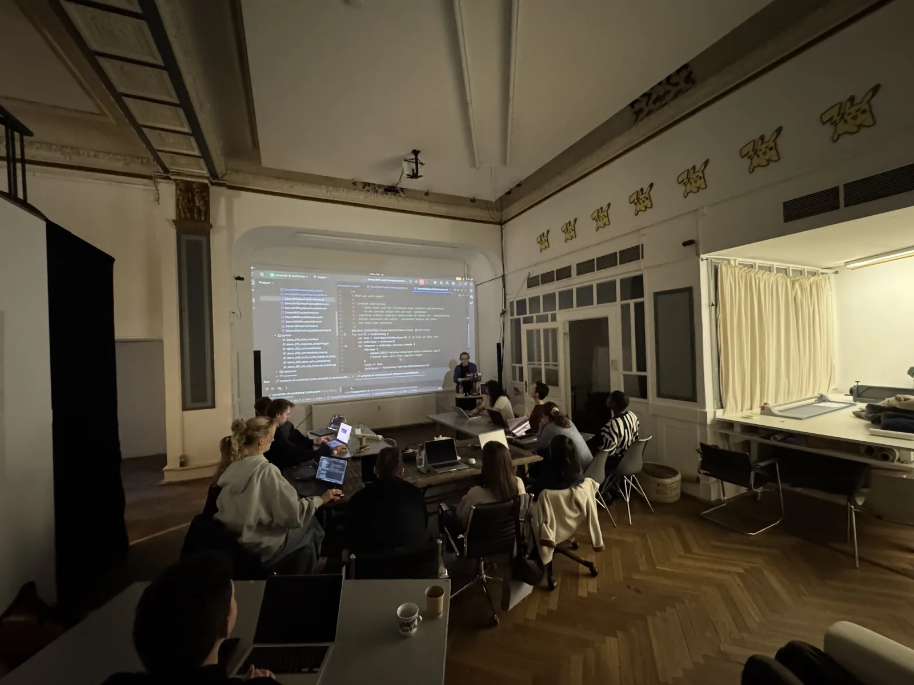
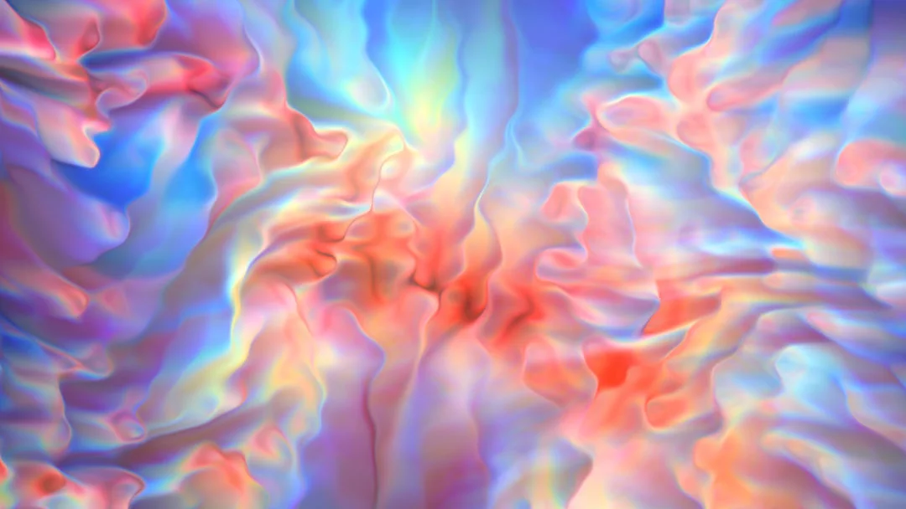

<h1 class="home-logo"></h1>

- Metacognitive AI
- Harness engineering
- Loop engineering
- Applied philosophy
- AI for Science

<article class="no-padding s12 m12 l6">

### Research

Metacognitive AI, autonomous research loops for science,
and the mathematics of perception —
our talks, reports and experiments.

<nav class="right-align">
<a class="button border" href="/consciousness/">Metacognitive AI</a>
<a class="button" href="/research/">Research</a>
</nav>

</article>

<article class="no-padding s12 m12 l6">

### Products

The Xemantic open-source ecosystem —
from a one-line assertion to a metacognitive AI harness:
Golem XIV, Honest Annie, Umwelt, markanywhere, Anthropic SDK Kotlin and more.

<nav class="right-align">
<a class="button border" href="/ai/">Xemantic AI Stack</a>
<a class="button" href="/products/">Products</a>
</nav>

</article>

<article class="no-padding s12 m12 l6">

### Services

Agentic AI workshops, AI consulting and software architecture —
two decades of engineering experience,
shared with the teams building their own AI agents.

<nav class="right-align">
<a class="button border" href="/ai/workshops/">AI Workshops</a>
<a class="button" href="/services/">Services</a>
</nav>

</article>

<article class="no-padding s12 m12 l6">

### Art

Generative visuals, interactive installations, live coding and emotional robots —
made with the artists of [Prachtsaal](https://prachtsaal.berlin/),
the art community we call home.

<nav class="right-align">
<a class="button border" href="/404/">404</a>
<a class="button" href="/art/">Art</a>
</nav>

</article>

