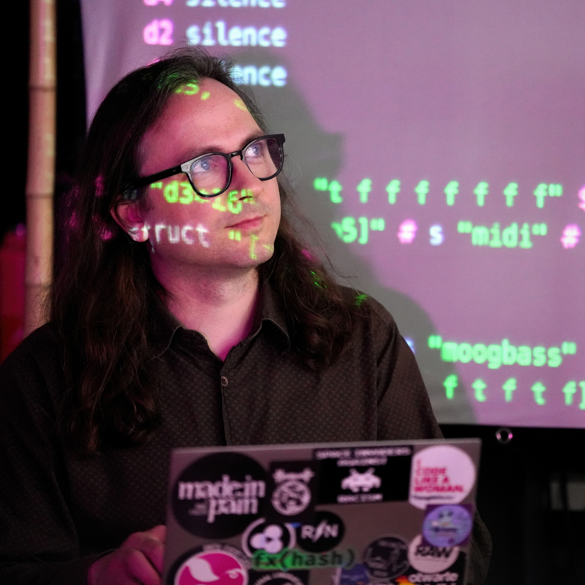

# Kazik Pogoda

<iframe style="width: 100%; aspect-ratio: 16 / 9; border: 0;" src="https://www.youtube.com/embed/rRjG86TAyq4" title="YouTube video player" allow="accelerometer; autoplay; clipboard-write; encrypted-media; gyroscope; picture-in-picture; web-share" referrerpolicy="strict-origin-when-cross-origin" allowfullscreen></iframe>

I am an independent AI researcher, open source enthusiast, open society advocate,
computational artist and live coder.
A programmer and software architect by trade, and a philosopher by education,
I have a longstanding interest in cognitive science and ethics.

I founded [Xemantic](../) (an applied philosophy collective)
and [Prachtsaal](https://prachtsaal.berlin) (an art community),
and I am currently affiliated with the [Foresight Institute](https://foresight.org/),
working at its Berlin AI Node.

## Resources

### Workshops

* [Agentic AI workshops](../ai/workshops/) —
  I have personally trained over a hundred participants in building agentic AI systems.

### Presentations

* [Agentic AI in Kotlin](../presentations/2025/kug-meetup-prachtsaal/) — Kotlin User Group meetup at Prachtsaal
* [Claudine](../presentations/2025/bonial/) — presented at Bonial

### Projects

* [Claudine](https://github.com/xemantic/claudine/) — an autonomous AI agent, older sister of Claude Code
* [Golem XIV](https://github.com/xemantic/golem-xiv) — a metacognitive AI system with knowledge-graph memory and self-directed research
* [404](../404/) — immersive computational art
* [OPENRNDR](https://openrndr.org/) — the creative coding framework I contribute to

## Elsewhere

* [LinkedIn](https://www.linkedin.com/in/kpogoda/)
* [GitHub](https://github.com/xemantic/)
* [YouTube](https://www.youtube.com/@KazikPogoda)
* [Vimeo](https://vimeo.com/kazikpogoda)

See also the other [humans](../humans/) behind Xemantic.
