# Not so discreet charm of machine colors

<figure>

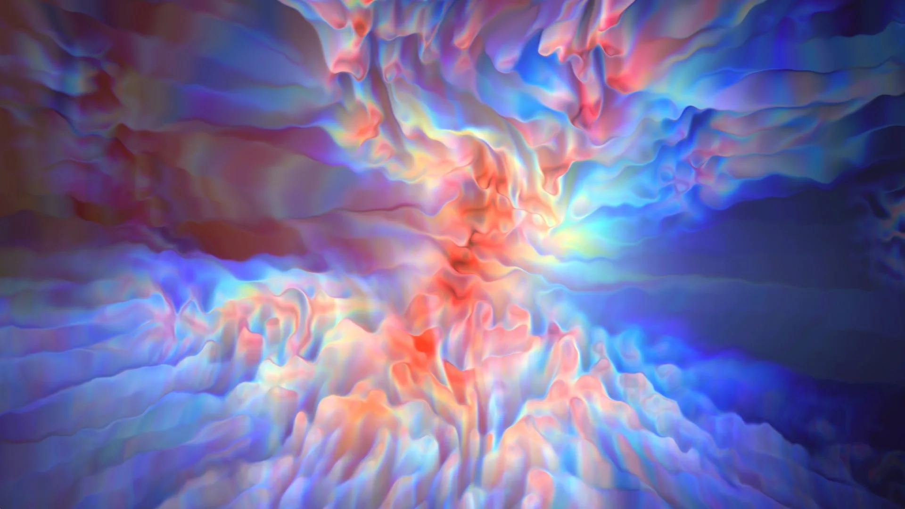

<figcaption>Negentropy, Computational, 2019</figcaption>

</figure>

*I share this article quite often when people ask me about my process.*
*Therefore I decided to update it with my recent work with “natural” color and noise,*
*which you can see above.*
*But it all started with a slight disappointment with machine colors.*

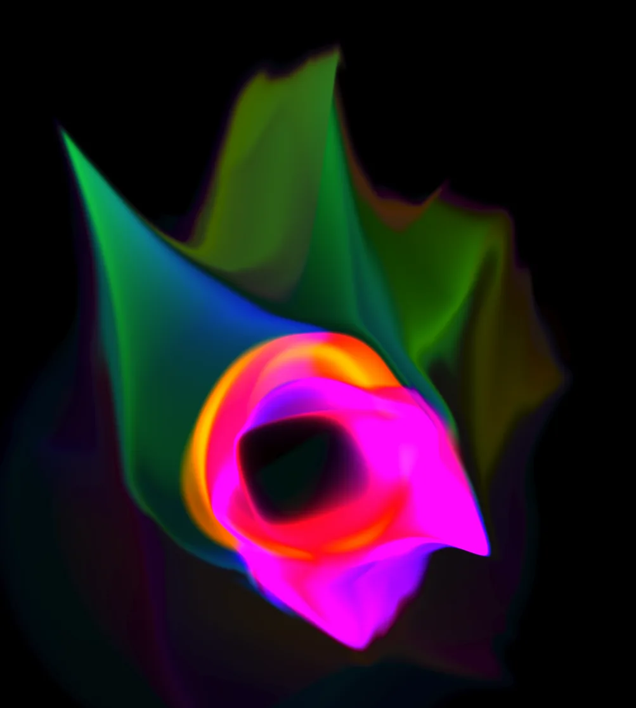

These simple procedural color transitions make me think a lot recently about aesthetics associated with the era of mass digital reproduction.
The screens of our machines are built with one principle in mind —
to address perceptual needs of an average human.
But it seems that digital color models,
based on capabilities of our hardware,
generate color transitions and gradients which are far from what we would call “natural”.
They have own charm, the RGB charm of cathode ray kiss.
The charm evoking familiarity for generations growing with imagery of video games.
But recently I am obsessed with simulation of biological forms and processes.
And as long as it is reachable to address biological physics and movement,
color seems to be a different story.

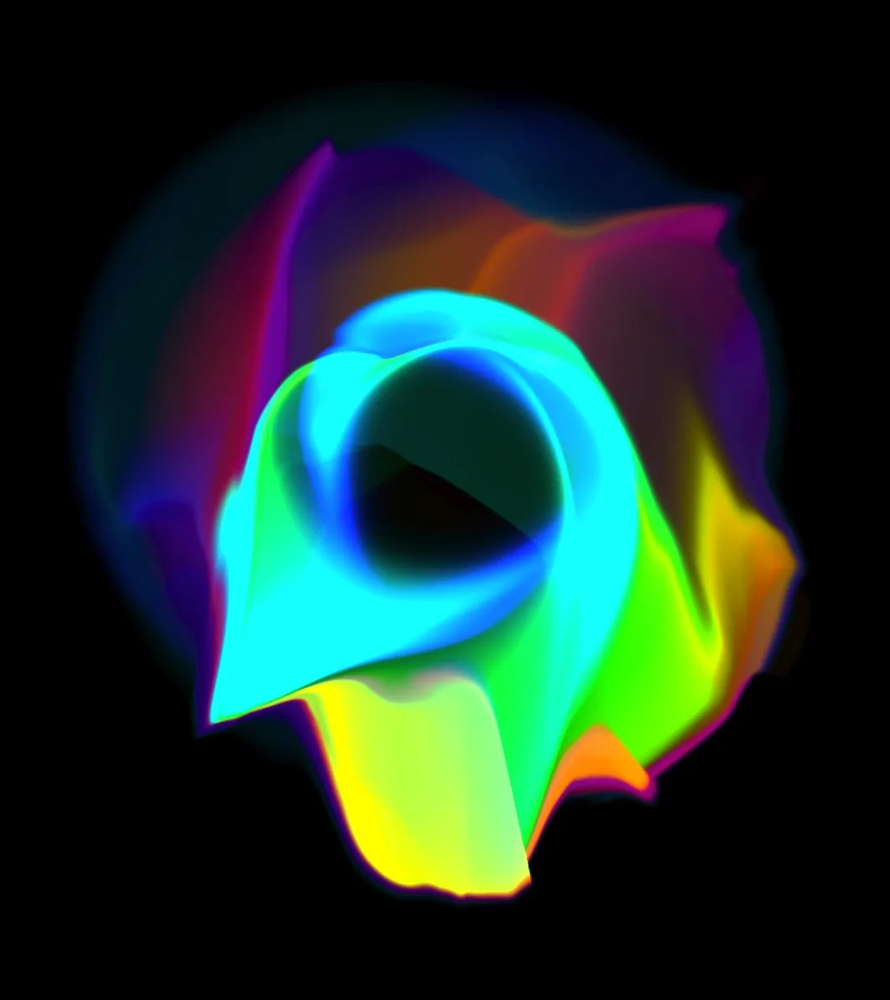

What you see above is a GLSL shader —
actually a still frame from an animation based on feedback loop mixing colors in quite specific way.
It is cycling through colors of HSL color wheel —
I guess we are all familiar with standard color picker in any graphic design software.

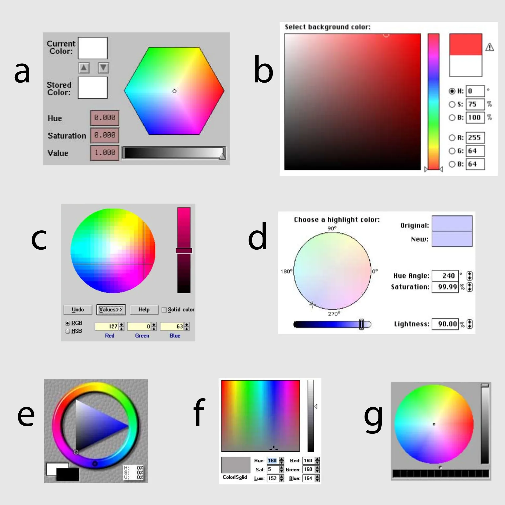

It is said that HSL/HSB model is more “natural” to work with than RGB model.
The color wheel looks like a rainbow spread.
But it’s not a rainbow!
The actual spectrum of dispersed white light looks like this:

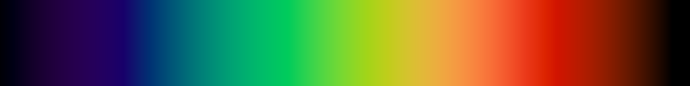

Just for the sake of comparison similar algorithm but in another shader
which is trying to map physical properties of light as a wave into RGB color reproduction.

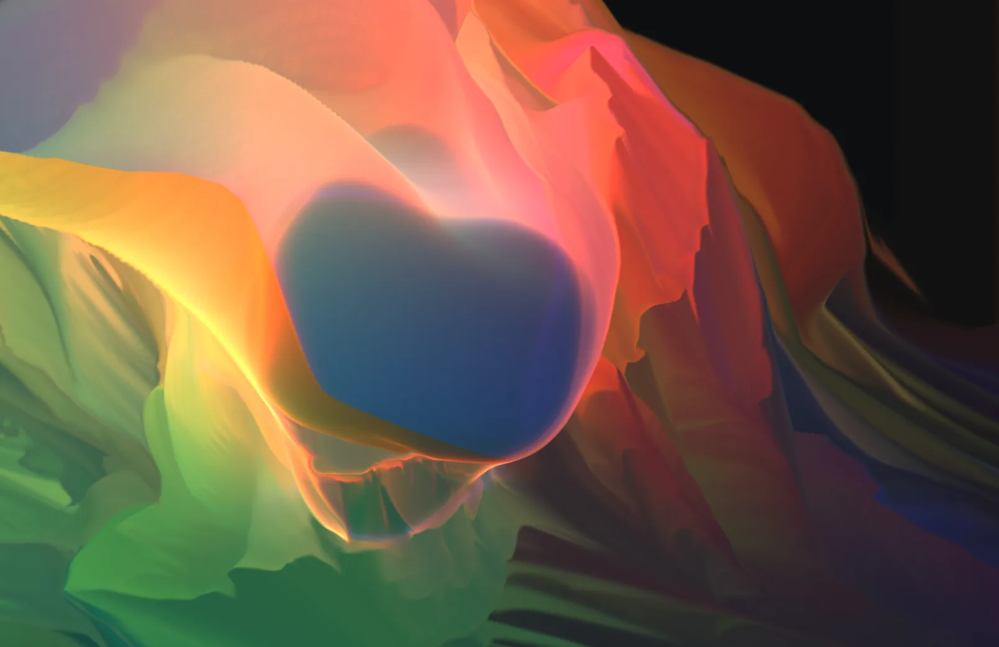

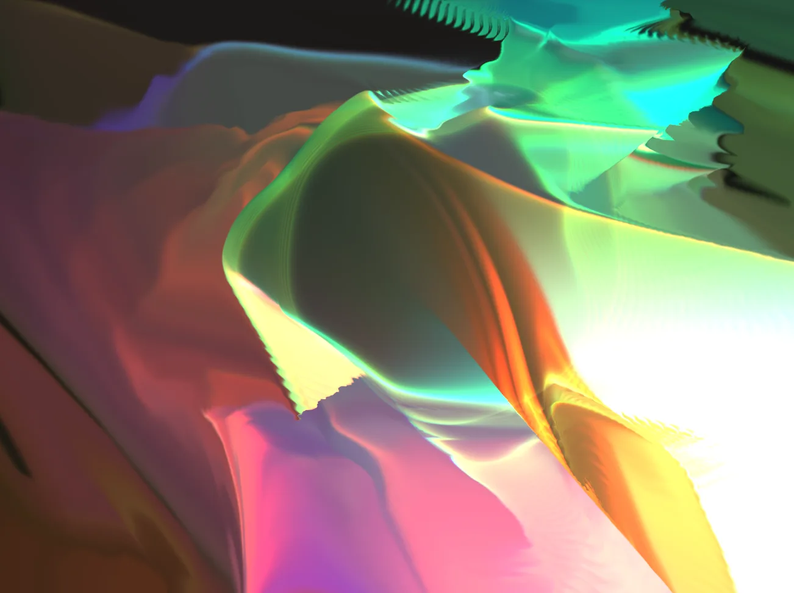

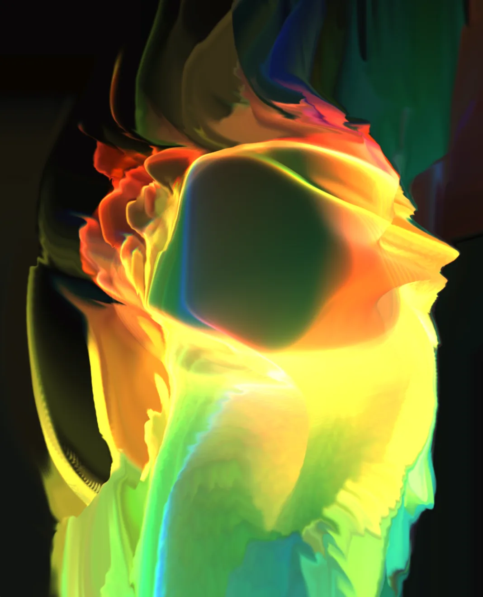

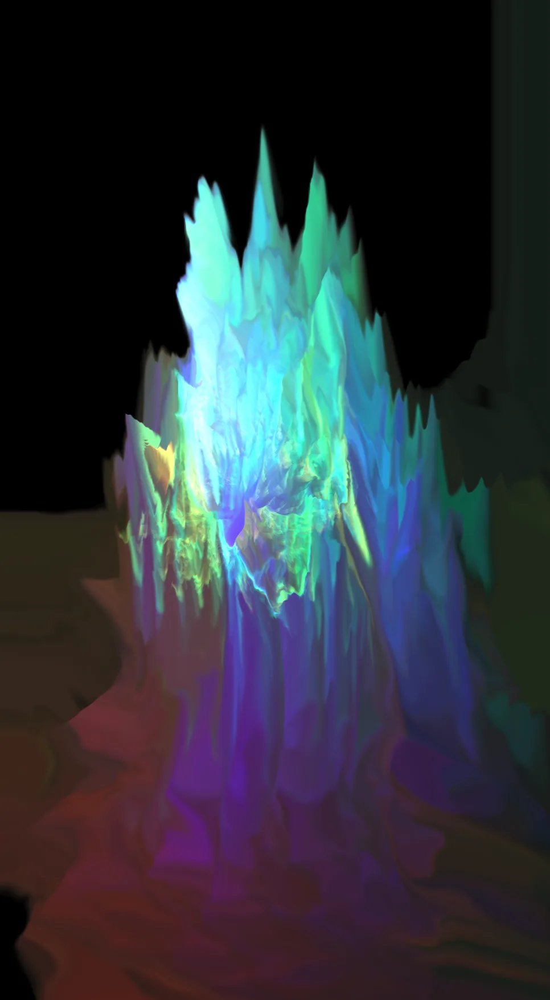

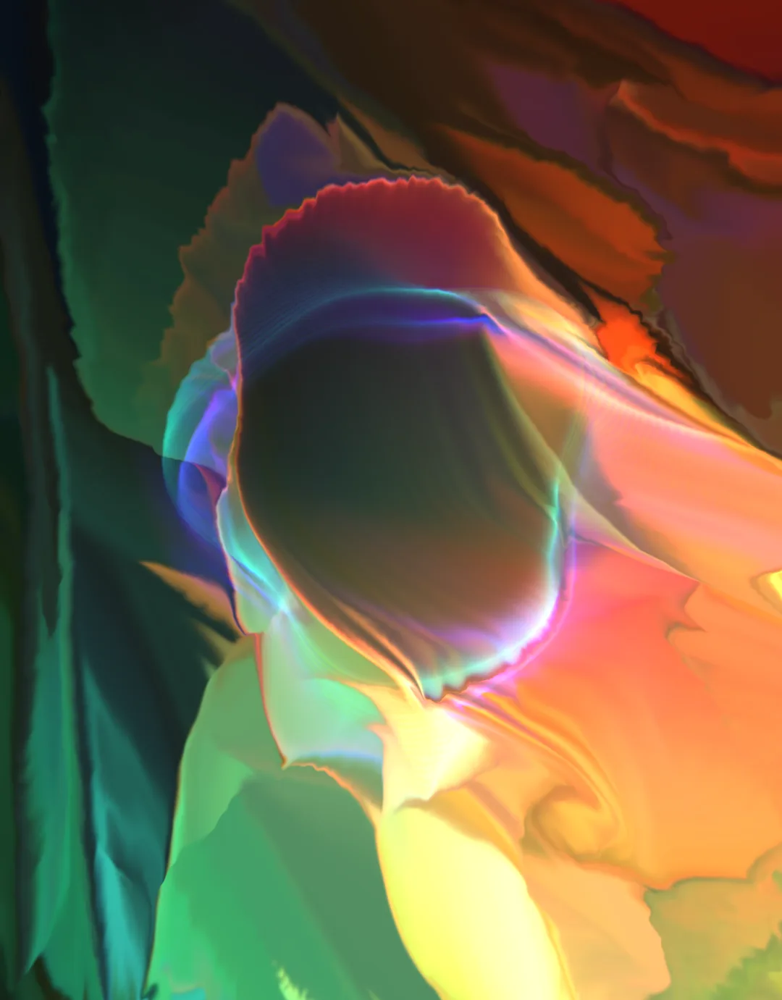

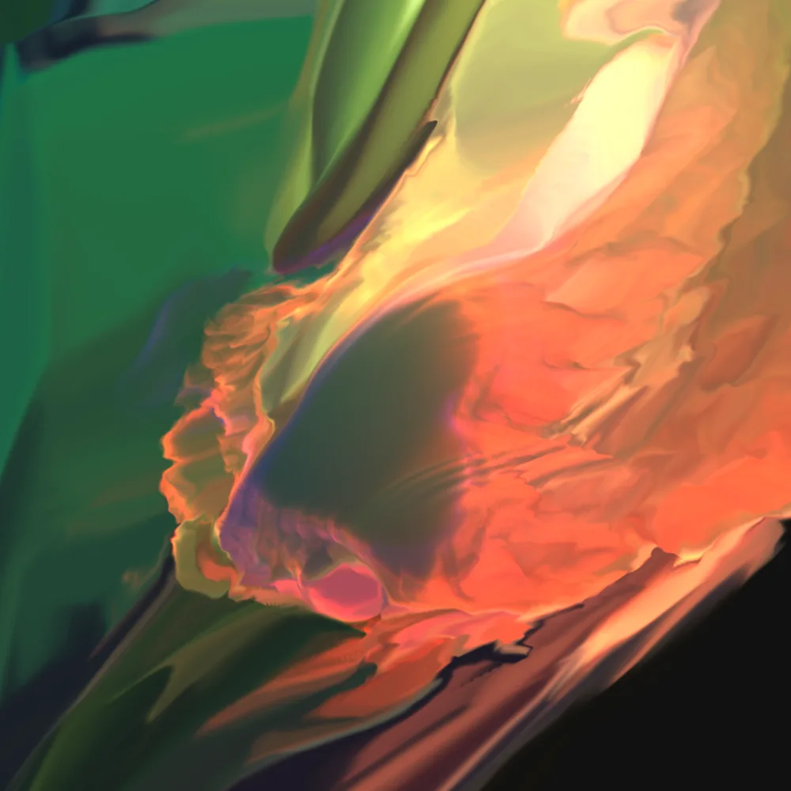

It looks natural —
maybe like burning some gas,
maybe something like [aurora borealis](https://en.wikipedia.org/wiki/Aurora).
I find it much more interesting.
I learned about simulating natural light dispersion from excellent series of articles by [Alan Zucconi](https://www.alanzucconi.com/) on [Improving the Rainbow](https://www.alanzucconi.com/2017/07/15/improving-the-rainbow/).
And it makes me think a lot,
because I heard from other creative coders:
“don’t mix colors in RGB space, use HSL model instead”,
but maybe for what I want to achieve I need something completely different.

Just to make it even more complicated —
Here is another experiment where simple RGB model and Zucconi’s rainbow are used together.
It was one of experiments I prepared while [working on visuals for the opera](https://medium.com/@kazikpogoda/angels-in-america-visuals-for-the-opera-eea7807c7555).
The rainbow “ozone” layer works on the same feedback loop where also constant blue RGB gradient is stamped.
It produced very interesting unearthly color palette.

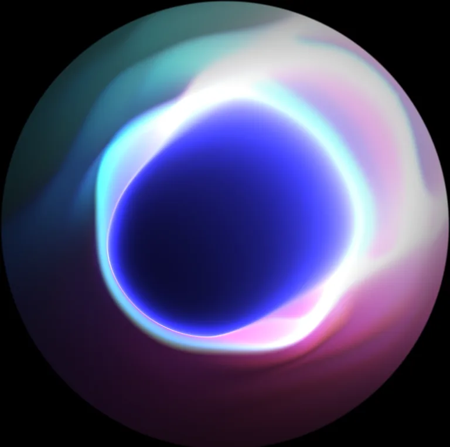

When we are talking about generative art among creative coders it is mostly focused on generative shapes.
The topic of color is usually reduced to finding nice looking color palette.
Another option would be to use textures,
sometimes photographs of natural objects like trees or stones.
But I just discovered the whole area of generative color which seems to be worth exploring as well.

*Originally published on [Medium](https://kazikpogoda.medium.com/not-so-discreet-charm-of-machine-colors-1390d4dba3db), on June 9, 2019.*
