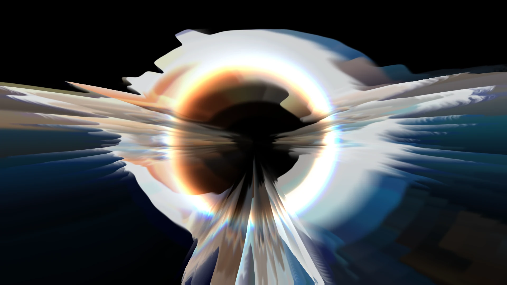
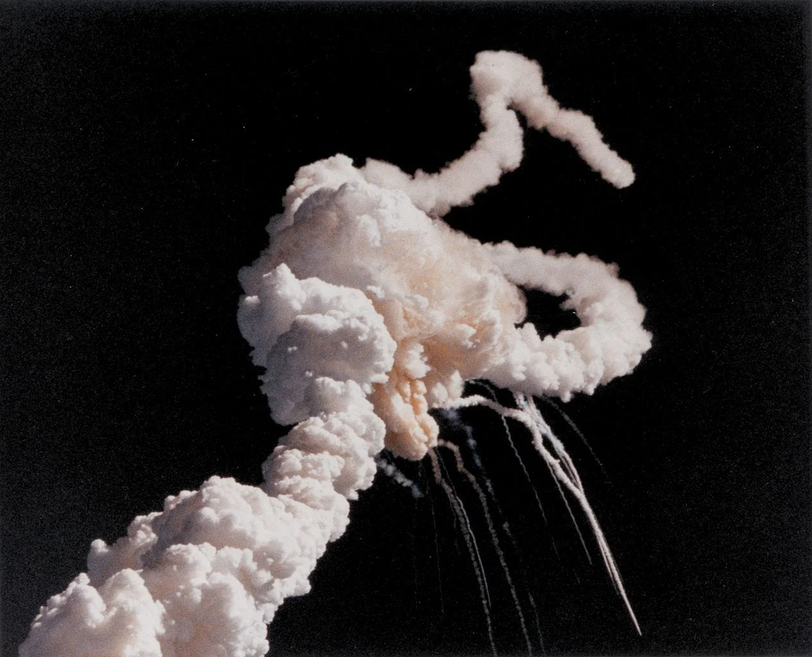
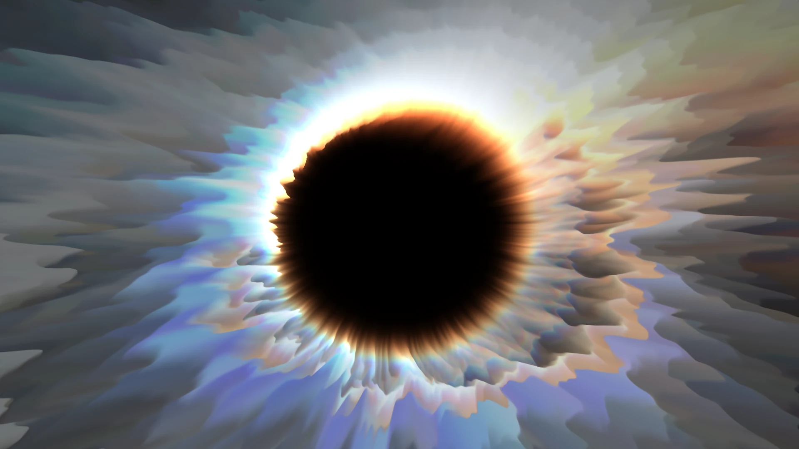

# The last flight of Challenger

Evolving ephemeral homeostasis against the forces of entropy.
This is how I generate these images.
This one makes me feel like if it was happening in space.
Not very far away from here,
but far enough to see the atmosphere of our planet from outside rather than from inside.
The energy of our sun received, captured, transformed and reflected as another wave.
When these images emerge on my screen,
having such a contrastive light in the total blackness,
I call them “the NASA aesthetics”.

The colors of total vividness,
like on these photographs sent from all these Majors Toms back to the ground control,
to stimulate the imagination of the masses,
and therefore justify another unbelievable amount of public spending against the gravity —
the enormous effort of sending another giant phallus into the darkness.

I wrote this algorithm also to meditate on my philosophical interests in the structure of reality.
But when I saw the outcome I immediately connected it with something much more dramatic,
which I remember from my childhood.

The explosion of Challenger space shuttle in 1986,
soon after the launch followed by millions,
with the first private US citizen on board —
a teacher who was supposed to broadcast the classes from space.
A female motherly figure speaking to the whole nation of the future astronauts.
North American version of [Valentina Tereshkova](https://en.wikipedia.org/wiki/Valentina_Tereshkova),
taken from the masses and speaking to the masses,
from the heights of heaven.

<figure>

<figcaption>Christa McAuliffe</figcaption>

</figure>

This time the phallus didn’t make it to the darkness,
but decomposed instead into beautiful composition.
The image which is now reproduced as an icon of 80'.
The epitaph for the 7 who died in the sky —
a composition of steam, smoke and fire,
almost like an abstract painting.
But it is symbolic instead,
representing both — the instant of their death and the tool of progress which killed them.
Worshiping symbols of objects which killed our beloved sons of man has a very long tradition in our culture, indeed.
So here it is, the quintessence of the phallic culture,
propelled by the unbelievable amount of energy,
to create a tiny new local homeostasis out of chaos.
In my mother tongue the entropy is feminine,
and she says “fuck yourself”.

*Originally published on [Medium](https://kazikpogoda.medium.com/the-last-flight-of-challenger-56d4abfc71db), on September 1, 2019.*
