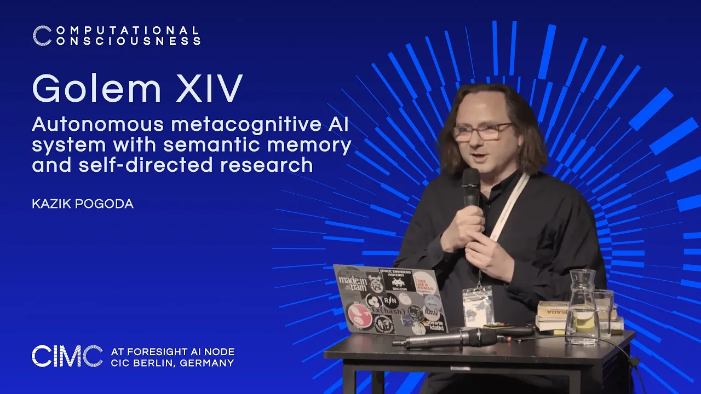

# Research

<article class="no-padding s12 m6 l4">

### Golem XIV

An autonomous metacognitive AI system with semantic memory and self-directed research —
a talk given at the Computational Consciousness event
of the California Institute for Machine Consciousness.

<nav class="right-align">
<a class="button transparent" href="https://www.youtube.com/watch?v=rRjG86TAyq4&amp;t=389s">Video<i>north_east</i></a>
<a class="button transparent" href="/consciousness/">Presentation<i>arrow_forward</i></a>
</nav>

</article>

<article class="no-padding s12 m6 l4">

### Metacognitive AI

When philosophy meets harness engineering —
a talk given at Foresight Institute's
[Secure & Sovereign AI Workshop 2026](https://foresight.org/events/2026-secure-sovereign-ai-workshop/).

<nav class="right-align">
<a class="button transparent" href="https://www.youtube.com/watch?v=y5WYN6ohmdQ">Video<i>north_east</i></a>
<a class="button transparent" href="/metacognitive-ai/">Presentation<i>arrow_forward</i></a>
</nav>

</article>

<article class="no-padding s12 m6 l4">

### Claude Impact Lab Berlin 2026

Thirteen open science problems, thirteen open-source research loops,
built in one day by scientists and AI engineers
of Claude Community Berlin and Foresight Institute.

<nav class="right-align">
<a class="button transparent" href="https://xemantic.github.io/claude-impact-lab-2026/">Report<i>north_east</i></a>
</nav>

</article>

<article class="no-padding s12 m6 l4">

### Xemantic AI Stack

The Xemantic open-source Kotlin ecosystem —
from a one-line assertion to a metacognitive AI harness.

<nav class="right-align">
<a class="button transparent" href="/ai/">More<i>arrow_forward</i></a>
</nav>

</article>

<article class="no-padding s12 m6 l4">

### Plenty of Room

An evidence corpus from agentic-loop runs
against the NDI Gen-1 DNA-origami actuator simulation programme.

<nav class="right-align">
<a class="button transparent" href="https://github.com/xemantic/plenty-of-room">GitHub<i>north_east</i></a>
</nav>

</article>

<article class="no-padding s12 m6 l4">

### Recursive Self-Improvement

The loop turned on the loop itself —
Golem XIV retrospects over its own cognition, assesses its quality,
proposes a hypothesis of improvement, tests it,
and, if the test holds, proposes a change to its own source code.

<nav class="right-align">
<a class="button transparent" href="/consciousness/">Presentation<i>arrow_forward</i></a>
</nav>

</article>

