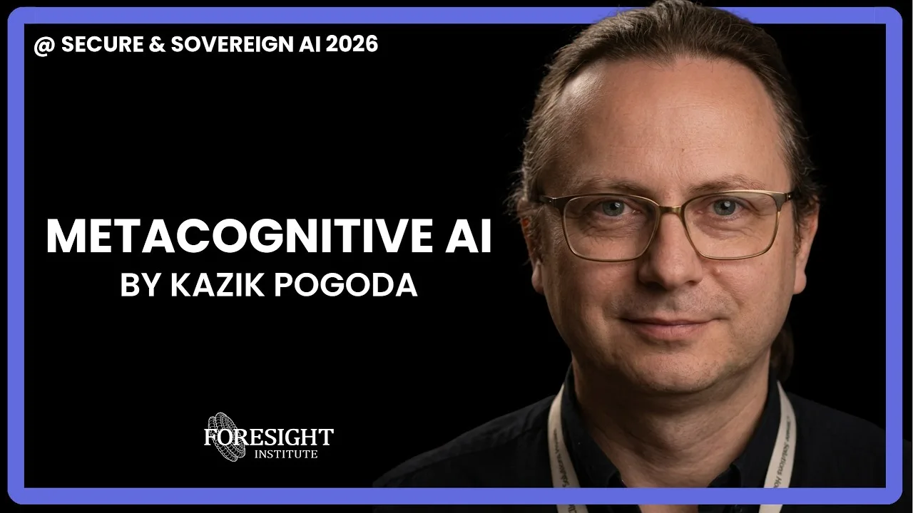
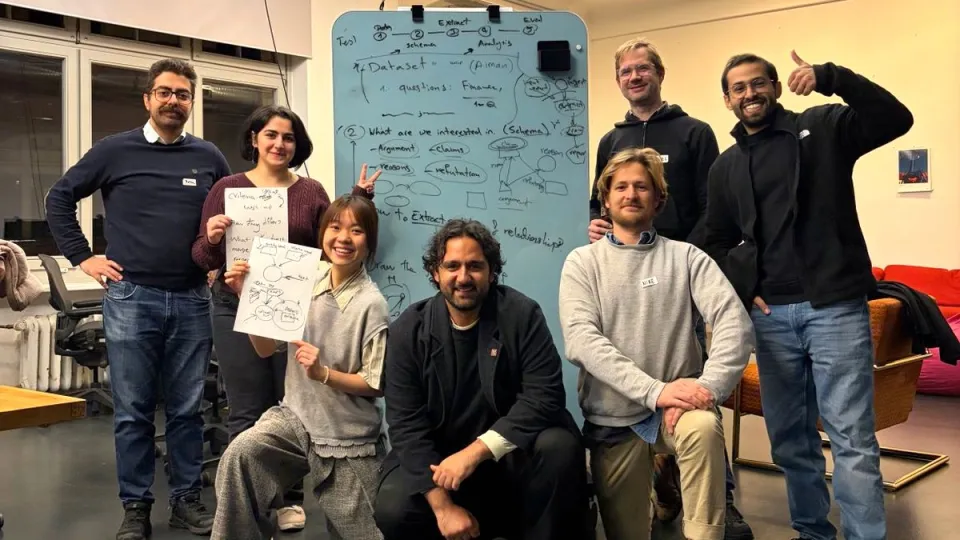
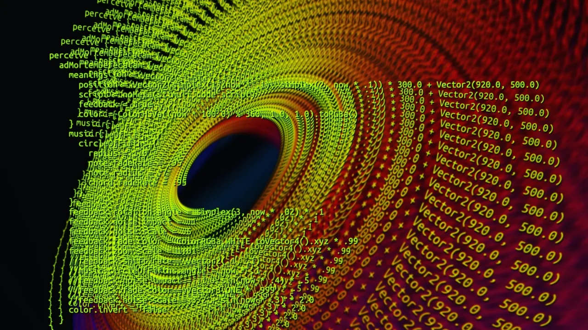
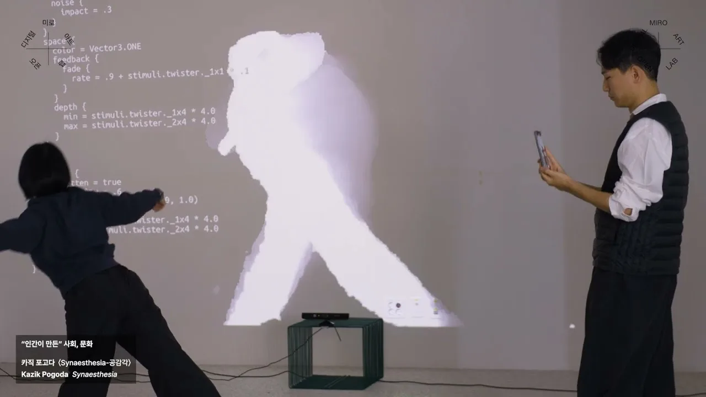

# Research

<article class="no-padding s12 m6 l4">

### Golem XIV

An autonomous metacognitive AI system with semantic memory and self-directed research —
a talk given at the [Computational Consciousness event of the California Institute for Machine Consciousness](https://cimc.ai/).

<nav class="right-align">
<a class="button border" href="https://github.com/xemantic/golem-xiv">Source</a>
<a class="button border" href="/consciousness/">Presentation</a>
<a class="button border" href="https://www.youtube.com/watch?v=rRjG86TAyq4">Video</a>
</nav>

</article>

<article class="no-padding s12 m6 l4">

### Metacognitive AI

When philosophy meets harness engineering —
a talk given at [Foresight Institute](https://foresight.org)'s
[Secure & Sovereign AI Workshop 2026](https://foresight.org/events/2026-secure-sovereign-ai-workshop/).

<nav class="right-align">
<a class="button border" href="/metacognitive-ai/">Presentation</a>
<a class="button border" href="https://www.youtube.com/watch?v=y5WYN6ohmdQ">Video</a>
</nav>

</article>

<article class="no-padding s12 m6 l4">

### AI for Science

Thirteen open science problems, thirteen open-source research loops,
built in one day at the Claude Impact Lab Berlin 2026
by scientists and AI engineers
of Claude Community Berlin and Foresight Institute.

<nav class="right-align">
<a class="button border" href="https://xemantic.github.io/claude-impact-lab-2026/">Report</a>
</nav>

</article>

<article class="no-padding s12 m6 l4">

### Xemantic AI Stack

The Xemantic open-source Kotlin ecosystem —
from a one-line assertion to a metacognitive AI harness.

<nav class="right-align">
<a class="button border" href="/ai/">Presentation</a>
</nav>

</article>

<article class="no-padding s12 m6 l4">

### Nanotechnology Research Automation

An agentic loop formulating, planning, executing and verifying
the simulation studies of a DNA-origami nanoactuator —
Plenty of Room keeps the whole record of its runs,
so that every claim can be checked against the evidence behind it.

<nav class="right-align">
<a class="button border" href="https://github.com/xemantic/plenty-of-room">Source</a>
</nav>

</article>

<article class="no-padding s12 m6 l4">

### Genomics Research Automation

The same research loop turned to genomics —
formulating a question, planning and executing the analysis of genomic data,
and verifying every claim against the evidence behind it.

</article>

<article class="no-padding s12 m6 l4">

### Recursive Self-Improvement

A research agent interacting with reality through specialized code —
Honest Annie stays constantly aware of its own algorithmic structure,
so that the LLM, its cognitive driver, can rewrite and evaluate
both its system prompts and the harness code itself.

<nav class="right-align">
<a class="button border" href="https://github.com/xemantic/honest-annie">Source</a>
</nav>

</article>

<article class="no-padding s12 m6 l4">

### Synaesthesia & the Mathematics of Perception

An interactive installation turning the movement of a body
into light and sound through live code —
presented at MIRO Digital Art Open Lab.

<nav class="right-align">
<a class="button border" href="https://www.youtube.com/watch?v=KGK2W7cwQuw">Video</a>
</nav>

</article>

