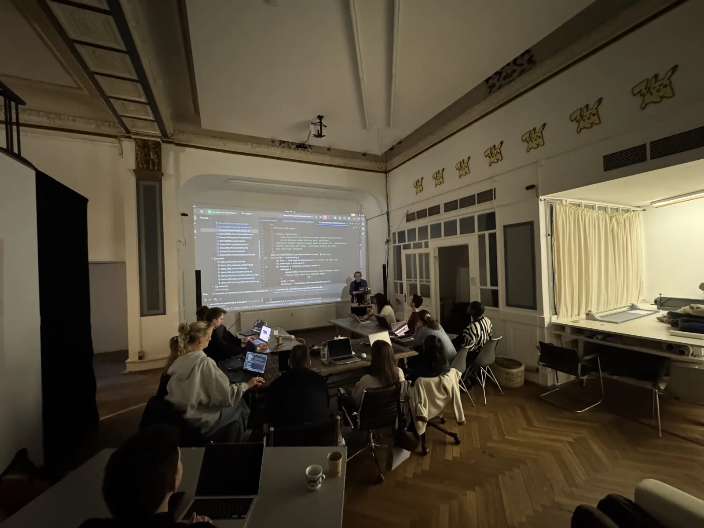

# Services

<h2 class="center-align large-padding bottom-padding">We teach how to build AI agents, and we help to put them to work.</h2>

<article class="no-padding s12 m12 l6">

### AI consulting

Guidance in bringing agentic AI into your organization —
from choosing the right use cases and architecture,
to agents running safely alongside your team and your existing systems.

<nav class="right-align">
<a class="button border" href="/contact/">Contact</a>
</nav>

</article>

<article class="no-padding s12 m12 l6">

### AI workshop

Hands-on training in building your own AI agents —
context engineering and harness engineering,
from the first lines of code to autonomous systems.
For individuals, and tailored to engineering teams.

<nav class="right-align">
<a class="button border" href="/ai/workshops/">Workshops</a>
</nav>

</article>

<nav class="center-align call-to-action">
<a class="button extra" href="mailto:office@xemantic.com"><i>mail</i>Write to us</a>
</nav>
